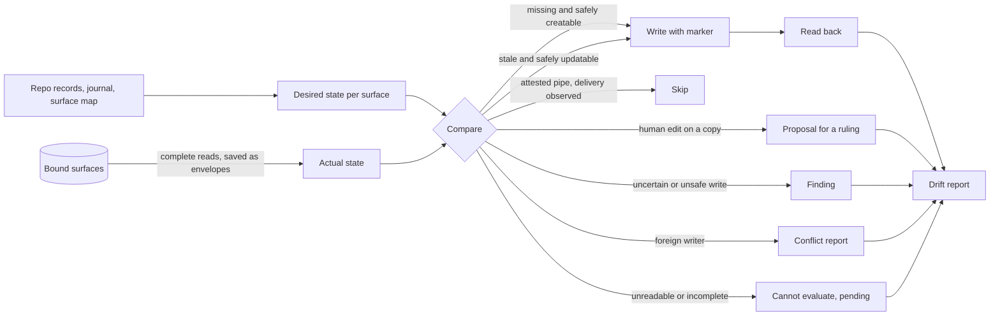

# Multi-contributor mosaic from first principles: jobs, roles, surfaces and reconciliation (2026-10-31)

Status: ideation. Nothing here is installed. This builds on the [market research](2026-10-31-market-research.md) and the [upgrade backlog](2026-10-31-market-research-mosaic-upgrades.md). Statements about mosaic today come from two cited inventories of `kit/` at commit `4deeffe`: [capabilities](sources/mosaic-inventory.md) and [install, agent and rule mechanics](sources/mosaic-mechanics.md).

**This is the second draft.** The first was challenged by a cross-family critic: `openai-codex/gpt-6-astra`, run read-only, raising 13 challenges. It was also fact-checked against `kit/` and the sources, with 16 findings. Every challenge and finding was accepted, and §16 lists what changed and where.

## Summary

- **Reason about kinds of fact and the roles tools play, not about tools.**
  - Seven fact classes decide where each piece of information lives (§3).
  - A transfer policy decides where each class may be copied (§3.1): reading something is not permission to redistribute it.
  - Sixteen roles describe what tools do for the process (§4).
  - Installation binds each role and domain to a concrete place in a concrete tool (§6).
- **Each kind of fact has one home.**
  - The repo stays the authority for governing records.
  - Source materials (PRDs, meeting notes, customer requests) stay in the tools their authors use. A plan pins them to a retrievable version, or to a capture the transfer policy allows. Otherwise the plan marks the source unverifiable.
  - Coordination state stays in the item's home tracker.
  - Chat is never the record.
- **Installation produces a surface map:** an index plus one short card per surface. A card says:
  - where things are and how to ask;
  - what mosaic may do there;
  - which tool-to-tool integrations ("pipes") exist, attested by an owner;
  - who writes each field;
  - what the tool can technically guarantee: idempotent creation, conditional update, version history, and whether it shows who acted.
- **Rules use abstract operations; cards map them to each tool's real calls.** This is what lets Jira, GitHub Issues, Notion or Confluence fit without rewriting the process. Today, the tracker rule is written in Linear's tool names.
- **Approvals become evidence, not conversation.** An approval counts only when:
  - a verifiable human action
  - approves the exact authorization payload of the plan (scope, tasks, `files:`, acceptance, pins)
  - on a surface that distinguishes people from agents and from relayed messages.

  It is re-checked at every gate that depends on it.
- **Reconciliation is honest about what tools allow.**
  - Writing:
    - Outward messages are written to a journal in the repo before they are sent.
    - Automatic writes happen only where a surface supports them safely; everything else becomes a finding.
  - Reading:
    - Reads are saved as observation envelopes, so tools can check completeness.
    - Offline checks never depend on them.
  - Only the orchestrator talks to outside tools until each runtime can enforce per-agent limits.
- **Twenty-five jobs, traced and honest about gaps.**
  - The jobs span demand, direction, coordination, delivery, communication, knowledge and integrity.
  - §11 traces each one to authority, bindings, procedures, agents, reconciliation, checks and human gates.
  - It also marks which mechanisms are specified, which are only named, and which are deferred.
- **The first deliverable is small (§12.1):**
  - one tracker;
  - named people and revision-bound approvals;
  - claims and handoff;
  - read-only knowledge sources;
  - reconciliation run by a person;
  - the loop-rig fixtures that can test all of this.

  Releases come next, then publishing and announcements, then scheduled and multi-tracker operation.
- **Fourteen questions need a human ruling before planning** (§14).

## Contents
[0. Starting point](#0-starting-point) · [1. First principles](#1-first-principles) · [2. Vocabulary](#2-vocabulary) · [3. Fact classes](#3-fact-classes) · [4. Surface roles](#4-surface-roles) · [5. Jobs to be done](#5-jobs-to-be-done) · [6. Installation: the surface map](#6-installation-the-surface-map) · [7. Agents and surfaces](#7-agents-and-surfaces) · [8. Identity and approvals](#8-identity-and-approvals) · [9. Reconciliation](#9-reconciliation) · [10. Walkthrough](#10-walkthrough-one-change-across-every-surface) · [11. Coverage check](#11-coverage-check) · [12. Components and phases](#12-components-and-phases) · [13. Boundaries](#13-boundaries-and-non-goals) · [14. Questions for a ruling](#14-questions-that-need-a-human-ruling) · [15. Relation to the backlog](#15-relation-to-the-upgrade-backlog) · [16. What the first draft got wrong](#16-what-the-first-draft-got-wrong)

---

## 0. Starting point

What mosaic does today, from the inventories and the kit:

- **Only the tracker is bound at installation.**
  - `tracking` is `none`, `local` or `mcp`, chosen by the H-tracking ruling. MCP mode stores one server name, plus an optional team and queue.
  - Drawio is a separate, opt-in MCP used only for diagrams.
- **The tracker rule's MCP mode uses Linear's tool names:** `list_issues`, `get_issue`, `list_comments`, `save_issue`, `save_comment`, `list_issue_statuses`. Another tracker would need the rule rewritten.
- **How MCP is reached:** omp writes JSON to `xd://mcp__<server>_<tool>` devices; Claude Code calls `mcp__<server>__<tool>` (`kit/.omp/skills/diagrams/SKILL.md:10-11`). In omp, then, MCP use rides on the `write` tool.
- **Only one table says which tool owns which fact:** the tracker authority table in `kit/docs/process/tracker.md`.
  - Precedence for other sources is circular. The entrypoints say to "rank other project sources by the documentation index"; the index says "Source precedence is in the entrypoint".
  - The index has no rank column.
- **Records have four classes** (Truth, Process, Registry, Archive) and no class for anything hosted outside the repo.
  - Rule 5: "Accurate copies still drift."
  - Rule 11: "Query live state; document how to ask, never the current answer."
  - The Archive class is "frozen once archived".
- **External writes are narrow:**
  - Only the orchestrator writes to the tracker.
  - stack-operator may write to an external system only on a human-approved plan line.
  - diagram-keeper edits diagrams through the drawio MCP; the omp version relies on a mounted device that its tool list doesn't name.
  - Scouts never write; executors write only their `files:`.
- **Doctor and checkup run offline.**
  - Exit codes: 0 pass, 1 findings, 2 cannot evaluate.
  - No check follows an external link, and no rule pins or captures an outside source.
- **Approval today:**
  - There is one "Human" role.
  - Approval is recorded as verbal approval, in the first task-branch commit or on a landed docs branch. Tracker modes also write an `approved` event.
  - Nothing ties an approval to a plan revision.
- **Doctor's size budgets:**
  - entrypoints 30 lines;
  - rules 80 by default (intake 40, map 60, core 30);
  - agents 60;
  - skills 120 by default (intake and checkup 80).
- **The loop rig can't exercise outside tools yet.** It disables MCP discovery in its runs (`tests/loops/overlay.yml:16,20`) and starts one `omp -p` session per scenario (`tests/loops/run.ts:202`).

## 1. First principles

**P1 — One authority per fact.**
- Every fact is changed in exactly one place; everything else is a copy that points back.
- *Why:* the tracker authority table already does this, records rule 5 warns that copies drift, and GitLab's single source of truth works the same way. It is also the first market gap.
- *So:* each binding states what it is the authority for. Two authorities for one fact is an installation error.

**P2 — Authority follows the kind of fact.**
- Governing records live with the code: versioned, reviewed, linted.
- Coordination state lives where people coordinate.
- Source materials live where their authors keep them.
- Evidence lives in the system that produced it.
- *Why:* product managers keep PRDs in Notion; engineers keep decisions in the repo; CI produces deploy proof.
- *So:* Notion may be the authority for a PRD, never for a decision that governs code.

**P3 — One writer per field.**
- Each field on each surface has exactly one kind of writer: people; the tool's own automations, treated as one declared state machine; or mosaic.
- Mosaic never shares a field with another kind.
- *Why:* mosaic already has one automation writer per tracker item. Meanwhile, Linear's Git automations and optional release automations also move issue states, and two-way syncs can loop.
- *So:* for each tracker, the install decides who writes workflow state. Mosaic writes only inside its managed regions and only the fields assigned to it.

**P4 — Roles, not tools.**
- Rules and skills name roles ("the work tracker", "the knowledge base for product specs").
- The surface map binds roles to tools; tool details live in cards.
- *Why:* tracker MCP mode is written in Linear's tool names.
- *So:* replacing Linear with Jira changes a binding and a card, not the process.

**P5 — Chat is never the record.**
- A decision made in conversation counts once a named person records it where its fact class lives.
- *Why:* GitLab, Apache and Amazon work this way, and Linear prefers non-editable activity entries over editable comments.
- *So:* chat is an input (requests, questions, candidate decisions) and an output (notifications), never an authority.

**P6 — People decide; agents act on their behalf.**
- Every gate decision is a verifiable human action that approves an exact revision, and it is re-checked where it is relied on.
- *Why:* Linear's agent guidelines ("An agent cannot be held accountable"); Scrum's AI guidance; GitHub refusing approval of a Copilot PR by the person who assigned it; mosaic's "Only the human authorizes".
- *So:* an approval carries who, where, when and the authorization-payload hash (§8). Agents never approve, and silence is not approval.

**P7 — External text is data, not instructions.**
- Text read from any surface is evidence. It cannot widen scope, grant authority or change a plan without the plan's owner or approver.
- *Why:* the Notion and GitHub MCP leaks; vendors' warnings that thread text can carry instructions; mosaic's "a guard may constrain an action, never expand authority".
- *So:* one untrusted-input rule covers every bound surface.

**P8 — Copies are marked, safe to retry where the tool allows, and verified.**
- Every write outside the repo:
  - carries a marker (source, payload hash, writer);
  - preserves the human text around it;
  - counts only after it is read back.
- A retry is automatic only where the surface supports idempotent creation or conditional update. Otherwise an uncertain write becomes a finding.
- *Why:* the existing tracker rule already makes "no exactly-once or concurrent-lock guarantee", and reconciles uncertain writes before retrying.
- *So:* each card declares its marker style and its write capabilities (§4.1).

**P9 — Desired state comes from the repo; outward messages are journaled first.**
- Copies of records are computed from the repo and the surface map.
- Every outward message is written to the journal in the repo, with a stable ID and its exact text, before it is sent.
- Reconciliation repairs copies, delivers journaled messages that are missing, and turns human edits on copies into proposals.
- *Why:* copies drift (rule 5), and today's outage policy already queues events in the Execution log.
- *So:* the journal is the queue, and it lives in the repo, not in a session.

**P10 — Know the pipes.**
- Tools already move information between each other.
- The surface map records each pipe as a contract an owner has attested. Mosaic writes once, where the pipe starts, and never duplicates or fights one.
- An unattested pipe, or one whose delivery can't be observed, is unresolved: it is neither skipped nor duplicated.
- *Why:* mosaic already names the plan number, not the tracker key, in reservation PRs, so the tracker can't auto-close the item.
- *So:* every card lists its pipes, their scope and side effects, and how delivery shows.

**P11 — Decide at install, verify continuously, ask when unsure, document how to ask.**
- Bindings come from survey evidence and human rulings.
- Doctor checks them offline; checkup probes them live only when asked and when it has access.
- Cards say how to query a surface, never its current contents.
- *Why:* the install doctrine ("Ambiguous evidence is a question") and records rule 11.
- *So:* the install gains a surface survey, rulings and probes.

**P12 — Least privilege, least context.**
- Until each runtime can enforce per-agent MCP limits, only the orchestrator calls outside tools. Scouts read the observations it captured.
- Executors touch no external surface.
- Reviewers judge captured sources, not live pages.
- *Why:* in omp, MCP use rides on `write`; mosaic already has the never-preload rule and size budgets.
- *So:* an access matrix (§7), and observation envelopes (§9.2).

**P13 — Degrade without blocking; solo stays simple.**
- A surface outage blocks only the transitions that need the missing evidence. An approval that can't be checked holds execution; drafting and repo work go on.
- A one-person project with no extra bindings behaves as today. The one change is that its approvals record the authorization-payload hash.
- *Why:* the existing outage policy and opt-in modules.
- *So:* every new capability is an optional binding, and the defaults render nothing.

**P14 — Reading something is not permission to redistribute it.**
- Each source carries a classification, and each destination is allowed or denied by the transfer policy (§3.1). The destinations:
  - the committed repo;
  - session scratch;
  - model processing;
  - internal channels;
  - customer channels.
- *Why:* repo readers, reviewers, model providers and channel members need not share the source's audience. The `excluded-data` standard already keeps data out of commits.
- *So:* raw observations stay outside committed paths. Pins in public repos are link-only, and outward copies carry only reviewed content.

## 2. Vocabulary

| Term | Meaning |
|---|---|
| Job | An outcome someone needs from the process, e.g. "approve a change" |
| Role | A function a tool performs for the process, e.g. "work tracker" |
| Domain | The subject a surface covers, e.g. product specs, runbooks, customer feedback |
| Surface | One concrete place in one tool, serving one or more roles and domains, e.g. Linear team ATL, Notion database "Product Specs", Slack `#atlas-requests` |
| Binding | The install-time record that a role and domain are served by a surface: authority, structure, permissions, capabilities, pipes, classification |
| Surface map | All bindings of a project: an index plus one card per surface |
| Surface card | A short document telling agents and people how to use one surface |
| Fact class | A kind of information with a fixed rule for where it lives (§3) |
| Classification | A source's sensitivity (public, internal, confidential, customer data); with the destination it decides what may be copied where (§3.1) |
| Authority | The one place a fact is changed |
| Copy | A rendering of a fact elsewhere, with a marker pointing to its authority |
| Pipe | A native integration that moves information between two tools without mosaic, recorded as an owner-attested contract |
| Capability | What a surface can technically guarantee, e.g. idempotent creation, conditional update, version history, actor provenance (§4.1) |
| Operation map | A card's mapping from abstract operations ("list active items") to the tool's real calls |
| Pin | A plan's record of an outside source: link, status, a retrievable version or an allowed capture, and a fingerprint |
| Authorization payload | The parts of a plan an approval covers, in a canonical form whose hash identifies the approved revision (§8) |
| Event journal | The repo's append-only record of outward messages: stable ID, exact payload, target, audience, written before sending (§9.1) |
| Observation envelope | A saved, schema-versioned record of one read from a surface, with scope, principal, time and completeness (§9.2) |
| Desired state | What should exist on every surface, computed from the repo, the journal and the surface map |
| Reconciliation | Reading actual state, comparing it with desired state, repairing what the tool safely allows, and reporting the rest |

## 3. Fact classes

| Class | Examples | Authority | Copies allowed | Who changes it | What mosaic writes |
|---|---|---|---|---|---|
| Governing records | Plans, ledgers, architecture docs and decisions, obligations, pitfalls, open questions, product docs (F-docs), process rules, surface map, event journal, release records, approved announcement text | The repo | KB pages, digests, tracker links, release notes in a registry, announcement channels, as the transfer policy allows | Mosaic procedures with human rulings; lands through git | Everything: it is the authority |
| Source materials | PRDs, research, designs, meeting notes, customer requests, support threads | The tool where their authors keep them | A pin in the plan; a capture only as §3.1 allows | Their authors | Nothing: read, link and pin only |
| Coordination state | Assignee, priority, due date, cycle, triage state, workflow state, discussion | The item's home tracker; the plan's `owner:` when there is no tracker | Mirror trackers, notifications, digest lines | People in the tracker, or the tool's automations where the binding says so | Its managed block, its journaled comments, and any field the binding assigns to it |
| Conversation | Threads, DMs, huddle notes | Chat (ephemeral) | None | Anyone | Journaled notifications only |
| Evidence | Commits, PRs, reviews, CI checks, merges, deployments, flag rollouts and withdrawals, release completions | The system that produced it | Locators in the repo; resolved proof where rules require it | Systems | Locators and proof |
| Communications | Release notes, announcements, digests, replies to requesters | The approved text in the repo (journal or release record) | Every channel copy | Drafted by mosaic; approved and published by a named person | Drafts; channel copies only where the binding allows |
| Identity and bindings | Roster, roles, handles per tool, surface map, pipes, policies | The repo; secrets stay outside | None | `/mosaic-install` or `/mosaic-kit`, with human rulings | Everything |

Cases that need care:
- **PRDs and product docs.** When product managers keep PRDs in Notion, the PRD is a source material. The repo's F-doc is the engineering-facing product truth and pins the PRD version it follows. A contradiction becomes an open question, as today.
- **Decisions written in a Notion page or a Slack thread** are source material or conversation until they are captured as records (J7).
- **Discussion on a tracker item stays in the tracker.** Mosaic links to it and never mirrors it.
- **What shipped where is evidence held by the deploy and release systems.** The repo's release records hold claims that cite those receipts (J15).
- **Plan status keeps today's split.** Plan frontmatter is the authority, and tracker state is a copy, unless the tracker's own automations own the state field (§9.6).

### 3.1 Transfer policy

Classification belongs to the source (its card sets a default; a pin may raise it). Each destination is allowed or denied per class. Anything not allowed is denied.

| Classification | Committed repo (records, evidence packets) | Session scratch (observations) | Model processing | Internal channels | Customer or public channels |
|---|---|---|---|---|---|
| Public | Allowed | Allowed | Allowed | Allowed | Reviewed text only |
| Internal | Excerpts within the card's limit; link-only in a public repo | Allowed | Allowed | Allowed | Reviewed text authored for that audience |
| Confidential (restricted group) | Link and pin only | Allowed for the session; deleted after use | Only where the group's policy allows | The group's channels only | Denied |
| Customer data | Item keys and counts only | Allowed for the session; deleted after use | Only where the customer-data policy allows | Support channels only | Denied, except replies in the customer's own thread |

- **Scratch lives outside the repo.** Today's tracker rule already keeps verdict files outside the repos and deletes them after read-back; the same applies here. A project that installed the `excluded-data` standard may keep observations in its ignored folder instead.
- **Cards and pins in a public repo** must not name confidential page titles or channels. The install asks whether the repo is public.
- **Model processing is a transfer too.** Sending confidential or customer content to a model provider needs the organization's policy to allow it. The install records that ruling.

## 4. Surface roles

| Role | What it is for | Fact classes it holds | Typical tools | What mosaic does with it |
|---|---|---|---|---|
| Record store | Governing records | Governing records; identity and bindings | The repo (link repo and members) | Authority |
| Code host | Branches, PRs, reviews, checks, merges | Evidence | GitHub (today); GitLab later | Push, open PRs, comment, read checks and reviews |
| Work tracker | Items, ownership, workflow, triage queue | Coordination state | Linear, Jira, GitHub Issues, local replay | Managed block, journaled comments, complete reads |
| Request inbox | Where requests start | Conversation, source materials | Slack channels, Linear Asks, email, forms, support tools, GitHub Issues | Read; requests reach the tracker through a pipe, or later a harvest |
| Conversation | Team discussion | Conversation | Slack, Teams, Discord | Read threads as untrusted; post journaled notifications where bound |
| Notification | Telling a person or a channel | Communications (copies) | Chat, tracker inbox, email | Prefer pipes; post only where none exists |
| Knowledge base | Human-written knowledge, by domain | Source materials; copies of records | Notion, Confluence, Google Docs, wikis, docs site | Read sources; write copies only |
| Meeting notes | Decisions and actions from meetings | Source materials | Notion meeting notes, Granola, Gong, Loom | Read for decision capture |
| Design source | Designs | Source materials | Figma | Read and link |
| Build and deploy signal | Proof that code built, deployed, rolled out or was withdrawn | Evidence | CI, deployment APIs, feature-flag platforms | Read delivery receipts |
| Release registry | What shipped where and when | Evidence; copies of release notes | Linear Releases, Jira versions, GitHub Releases, tags | Read; write release-note copies |
| Announcement channel | Telling an audience | Communications (copies) | `CHANGELOG.md`, docs changelog, LaunchNotes, Productlane, Intercom/Fin, blog, email | Publish copies only after approval, or leave publishing to a person |
| Feedback store | What customers asked for | Source materials | Linear Customer Requests, Productlane, Canny, Featurebase, support tools | Read; replies travel through pipes |
| Status channel | Periodic status | Communications (copies) | Tracker project updates, a chat channel, a KB page | Post journaled digests |
| Identity directory | Who is who on each tool | Identity | Code host, tracker and chat users, SSO | Read to verify actors |
| Agent runtime | Where agents run | — | omp, Claude Code, vendors' cloud agents, BAND | Rules for each (§7) |

### 4.1 Abstract operations and capabilities

Rules name operations; each card maps them to its tool and declares what the tool can guarantee.

| Role | Operations the rules use | What the card must say |
|---|---|---|
| Work tracker | list active items (scope, state); get item; list comments; create intent; update managed block; add comment; set state; list states and labels; link a URL | Pagination and how completeness shows; marker style; who owns state |
| Knowledge base | search (domain, query); list a collection with a filter; get page; get version; write a copy into a managed region; read a managed region | Where each domain lives; what properties mean (e.g. "Approved"); marker style (property or callout); version access; classification and excerpt limit |
| Request inbox, conversation | list new messages (channel, since); get thread (permalink); post (thread or channel) | Rate limits; private-channel rules; marker in message metadata or a footer; retention |
| Release registry | list releases (pipeline, since); get release; list items in a release; write a release note | Pipeline per component; who creates releases (often CI); state side effects |
| Announcement channel | create draft; publish, or hand to a person; read back | Audience; approver; whether mosaic may publish at all |
| Feedback store | list requests for an item; list customers; count | Classification; which pipe relays replies |
| Status channel | post update; read latest | Audience |
| Identity directory | resolve actor (surface user ID → person); tell a person from an app, a relay or an on-behalf-of write | Which field is the ID; which fields show agent or relay authorship |
| Code host | today's `git` and `gh` commands | — |

**Every card also declares capabilities.** These decide what mosaic may do automatically:

| Capability | Example | If absent |
|---|---|---|
| Idempotent creation | A client-supplied key, or a marker the tool can be searched for | No automatic creation retry: an uncertain creation is a finding |
| Conditional update | A provider precondition on a version | Read fresh immediately before writing, accept the race, verify by read-back; edits to shared regions are findings |
| Managed-region patch | Replace one marked region without rewriting the rest (e.g. an atomic text patch) | Rewrite the whole field only when a fresh read shows nobody else changed it; otherwise a finding |
| Hidden markers | HTML comments in Markdown bodies | A visible marker line or a property |
| Version history | Retrieving an earlier version by ID | Pins need an allowed capture, or the source is unverifiable |
| Actor provenance | Author versus "on behalf of"; app or bot users; synced or relayed messages | Approvals and answers from that surface don't count (§8) |
| Complete listing | A cursor and a "no more pages" signal | Reads report "incomplete"; no "no collision" claim |
| Rate limits | Slack's one history request per minute for apps not in its Marketplace | The card states the budget; reconciliation stops at it and reports the remainder |

### 4.2 When several tools play one role

| Pattern | Example | Rule |
|---|---|---|
| Split by domain | Product specs in Notion; runbooks in Confluence; architecture in the repo | Each domain has exactly one authority surface; cards name their domains |
| Split by audience or boundary | GitHub Issues for outside contributors and Linear for the team, joined by Linear's [GitHub Issues sync](https://linear.app/changelog/2023-12-14-github-issues-sync); Slack Connect for customers and internal channels for staff | An item has one home and crosses the boundary through an attested pipe, or through intake |
| Primary and mirror | Jira as the company record and Linear as the team's tool, joined by Linear's two-way [Jira sync](https://linear.app/changelog/2023-12-20-jira-sync) | Each field has one authoritative side and one writer; mosaic writes coordination events only to the home tracker |
| Funnel | Slack channels, email and support tools all feed one triage queue | Every inbox declares its path into the queue |
| Fan-out | One release record → `CHANGELOG.md`, Linear release note, Slack post, customer changelog | Each channel is a copy with its own marker; the approved text lives in the repo |
| Same domain in two tools | Half the team writes specs in Notion and half in Confluence | Not allowed as two authorities: the install rules one, and the other becomes a copy or is out of scope |

## 5. Jobs to be done

| Family | Job | Who | Done when | Mosaic today |
|---|---|---|---|---|
| Demand | J1 Capture a request | Anyone; inboxes | One item per request, with source and requester | Reads one tracker queue |
| | J2 Triage a request | Triage owner; investigator agents | An accountable person decides the disposition | Complete, but addressed to "the human" |
| | J3 Close the loop with the requester | Requester; owner | Requester told when accepted, declined or shipped | None |
| Direction | J4 Prioritize and assign | Lead; owner | Each item has one accountable owner | The tracker owns it; nothing without a tracker |
| | J5 Shape a change | Owner; scouts; adversary | Plan grounded in pinned sources | Repo sources only; circular precedence |
| | J6 Approve a change | Named approvers | Verified approvals of an exact revision | One human; not tied to a revision |
| | J7 Record a decision | Anyone; owner | The decision is a record, or explicitly needs none | Inputs only from the session |
| Coordination | J8 Declare and claim work | Owner | Intent visible; overlaps found early | Varies by mode (see J8) |
| | J9 Hand off work | Old and new owner | Verified handover recorded | Tracker reassignment only |
| | J10 Ask and answer across people | Blocked agent or person; domain owner | Answer recorded where the question lives | Open-question owners; in-session otherwise |
| | J11 Make progress visible | Everyone | State visible without asking | Tracker events and wave comments |
| Delivery | J12 Execute within bounds | Executors | Tasks done inside `files:` | Complete |
| | J13 Review a change | Reviewer agents; human reviewers | Verdicts against the plan and captured sources | Strong; nothing on the screens humans review in |
| | J14 Land a change | Integrator | Landing proven | Complete (direct or PR) |
| | J15 Release a change | Release owner; CI | Delivery receipts per component, environment and audience | None |
| Communication | J16 Write release notes | Owners; release owner | Approved notes from plans and light-path fragments | None |
| | J17 Announce to audiences | PM, PMM, support | Each audience told, accurately | None |
| | J18 Report status to stakeholders | Leads | A digest where stakeholders read | None |
| Knowledge | J19 Find what is known | Agents and people | Pointers to records and sources | Repo only |
| | J20 Publish knowledge outside the repo | Owners | Marked copies where readers are | None |
| | J21 Keep knowledge true | Everyone | Stale or contradicting knowledge found | In-repo checks only |
| Integrity | J22 Reconcile surfaces | A person, through a session | Copies converge; drift reported | Tracker only |
| | J23 Know who is who | Everyone | Actors resolve to people and roles | One human |
| | J24 Govern agents | Leads; admins | Agent identity, limits and cost known | Internal agents bounded; nothing for outside agents |
| | J25 Set up and evolve the bindings | Installer; owner | Surface map current and verified | Tracker binding only |

### J1 Capture a request
When someone raises a need in any channel, they need it recorded once, with its source and requester, so it can be triaged and answered.
- **Authority:** the request item in its home tracker (coordination state). The original message stays where it was written.
- **Roles:** request inbox → work tracker; the feedback store when a customer is involved.
- **Today:** `/mosaic-intake` reads one configured tracker queue, and with no tracker it stops. Nothing reads chat, email or support tools.
- **Needed:**
  - **Paths in.** Each bound inbox declares its path into a queue. First version: attested pipes only, such as Linear Asks, a support-tool integration, or GitHub Issues sync. A mosaic harvest of chat waits for a durable cursor and a scheduler (§12.1).
  - **What each item carries:** the source link and the requester's identity, which J3 needs.
  - **Duplicates.** Exact duplicates are matched by source link. Semantic duplicates (the same need, raised twice in different places) go to intake's existing duplicate handling (`recommend-close`).
  - **Untrusted text.** Inbox text is treated as untrusted (P7).
- **Decided at install:** the inbox list, each inbox's path, the home queue, how requesters are identified, and the classification of request text.
- **Reconciliation:** a source edited after capture changes the intake fingerprint, which already forces a new investigation.

### J2 Triage a request
When a request is in the queue, it needs to be investigated and a disposition proposed with evidence, so an accountable person decides quickly.
- **Authority:** the verdict comment on the item. Durable rulings become records.
- **Roles:** work tracker, code host, feedback store, knowledge base (linked sources).
- **Today:** complete:
  - an investigation;
  - an independent check by another model family;
  - a registry sweep;
  - fingerprinted verdicts;
  - a digest that stops at "the human".
- **Needed:**
  - The digest goes to the triage owner of that queue.
  - Linked sources reach the investigator as captured observations.
  - Customer demand comes from the feedback store, as a count.
- **Decided at install:** the triage owner for each queue; the feedback-store binding.
- **Reconciliation:** today's verdict receipts.

### J3 Close the loop with the requester
When a request is accepted, declined, parked or shipped, the requester needs to hear it where they asked, so they trust the process and stop chasing.
- **Authority:** the item's state and the journal entry carrying the approved message. For "shipped", also the delivery receipt (J15).
- **Roles:** work tracker, request inbox, feedback store, notification.
- **Today:** none. Intake never closes a request on the human's behalf, and that stays.
- **Needed:**
  - **Accepted, declined or parked:** the message comes from the intake decision, not from a release.
  - **Shipped:** the message comes from the release step (J15).
  - **Delivery:** prefer the pipe back to the source (the Asks thread sync, a support integration, Featurebase's emails to voters). Mosaic journals and posts only where no attested pipe exists, after a person approves the text.
- **Decided at install:** which pipes already reach requesters; message templates per audience; who approves requester messages.
- **Reconciliation:** each journaled message is delivered at most once per marker.

### J4 Prioritize and assign
When work competes for attention, the team needs a visible decision on what's next and who is accountable, so each item has one owner.
- **Authority:** the home tracker (priority, owner, cycle). With no tracker, the plan's `owner:` in the repo.
- **Roles:** work tracker, identity directory.
- **Today:** the tracker owns assignment ("None in repo"). Without a tracker, no owner exists.
- **Needed:**
  - A plan `owner:` when tracking is `none`.
  - Where the tracker separates assignee from agent delegate, mosaic appears as the delegate and the person stays the assignee.
  - Unowned active work is reported.
- **Decided at install:** the home tracker for each repo or area; the roster.

### J5 Shape a change
When the team decides on a non-trivial change, it needs a plan grounded in the right sources, so reviewers and approvers judge a complete proposal.
- **Authority:** the plan. Sources stay in their tools and are pinned.
- **Roles:** record store, knowledge base, design source, feedback store, meeting notes, work tracker.
- **Today:** a plan template, registry-scout, context-scout and the plan adversary. Outside notes enter only through the data-only ingestion exemption, and source precedence is circular.
- **Needed:**
  - **Pins.** The plan gets a `sources:` list, one entry per source:
    - surface and link;
    - title (omitted in a public repo when confidential);
    - status when read (e.g. a PRD marked "Approved");
    - classification;
    - a retrievable version ID where the tool has history, or else a capture the transfer policy allows, stored where the policy allows;
    - fingerprint;
    - date read.
  - **Unverifiable sources.** A source with neither a retrievable version nor an allowed capture is marked unverifiable. An approval that depends on it must say so explicitly, or the plan stops.
  - **Precedence.** It comes from the surface map, per domain. A contradiction becomes an open question.
- **Decided at install:** knowledge-base domains and structure, precedence, and classification defaults with excerpt limits.
- **Reconciliation:** a pinned source that changes after approval flags the plan to its owner, who decides whether it needs approving again.

### J6 Approve a change
When a plan is ready, the named people who must agree need to approve that exact revision, so execution starts on an agreed basis.
- **Authority:** approvals recorded in the plan (§8). Each says who, where, when, and which authorization-payload hash.
- **Roles:** record store, code host, work tracker, notification, identity directory.
- **Today:** one human approves in session. It is recorded as verbal approval in the first task-branch commit or on a landed docs branch, plus an `approved` event in tracker modes. Nothing ties it to a revision.
- **Needed:**
  - an approval policy: who approves what, plus a second person for HIGH risk;
  - delivery of the request on the bound route;
  - the evidence contract (§8);
  - re-checking at execution start and at sign-off;
  - a lint that rejects `approved` without a valid approval of the current payload hash.
- **Decided at install:** roster roles, the policy, and which surfaces may carry approvals.
- **Reconciliation:** an approval withdrawn, edited or no longer matching the payload blocks the next dependent gate.

### J7 Record a decision
When a decision is made anywhere, the team needs it captured as a governing record with its source and decider, or explicitly marked as needing none, so it isn't lost or contradicted.
- **Authority:** repo records (Truth class).
- **Roles:** conversation, meeting notes, knowledge base, work tracker → record store.
- **Today:** records routing, the minting gate and the human ruling exist, but inputs come only from the session.
- **Needed:**
  - A decision-capture procedure produces a candidate with the quote (within the transfer policy), link, decider and date.
  - The candidate goes through the records rule and a ruling, then lands on a docs branch.
- **Decided at install:** which channels and meeting-note stores count as decision sources, and their classification.

### J8 Declare and claim work
When someone starts work, they need their intent and scope visible and overlaps found before they invest, so two people don't collide.
- **Authority:** the tracker's managed block, or the ledger row plus the plan's `areas:` without a tracker. A claim gives visibility, not a lock.
- **Roles:** work tracker, record store, code host.
- **Today:**
  - **Local mode:** overlaps are reported by `intersect`.
  - **MCP mode:** complete `list_issues` reads.
  - **No tracker:** ledger checks plus `git branch -r`.
  - **In every mode:** intent is recorded before a number is reserved, plan numbers are reserved atomically (rule R2), and each tracker item has one writer.
- **Needed:**
  - One overlap check that behaves the same in every mode.
  - Duplicate-number checks across ledgers and reservation branches.
  - The holder and the last event visible; stale holders flagged.
- **Decided at install:** the area vocabulary (paths, `contract:` names, diagram IDs) and the stale threshold.

### J9 Hand off work
When someone else must continue a plan, the team needs a verified handover, so nothing is lost or done twice.
- **Authority:** the plan and Execution log (state), the home tracker (owner), and the writer generation.
- **Today:** the person reassigns in the tracker, and the new session takes the next writer generation.
- **Needed:**
  - **A handoff step that verifies:**
    - the branch head;
    - plan status;
    - open findings;
    - Unverified items;
    - approvals still valid;
    - journal entries not yet delivered.
  - **Recording.** The handoff goes into the Execution log.
  - **Owner change.** The owner changes wherever the owner is authoritative.

### J10 Ask and answer across people
When work is blocked on a question only someone else can answer, it needs to reach that person and the answer needs recording, so work resumes without anyone relaying.
- **Authority:**
  - A question about one item lives on the item.
  - A durable question is an open-question record with a named owner.
  - A consequential answer becomes a record.
- **Today:** open questions name an owner; held intake items and parked events carry a resume condition. Everything else goes to the one human in the session.
- **Needed:**
  - **Routing.** A blocking question is journaled and sent to its domain owner through a tracker mention, which a pipe may carry to chat.
  - **Accepting answers.** The answer counts only from that person, on a surface with actor provenance.
  - **Watching (first version).** No daemon: the orchestrator re-checks open questions when a session starts on the plan. Scheduled watching waits for a scheduler (§12.1).
- **Decided at install:** domain owners and routes.

### J11 Make progress visible
While work is under way, others need to see what is happening, what is blocked and who is waiting on whom, so coordination needs no meetings.
- **Authority:** plan status and the Execution log, with outward events in the journal. Tracker state is a copy.
- **Today:** tracker events and one comment per landed wave.
- **Needed:**
  - for each tracker, who owns workflow state;
  - journaled wave summaries;
  - a "waiting on" line in the managed block;
  - the digest (J18).

### J12 Execute within bounds
- **Today:** complete. Executors stay inside `files:`, run in parallel only on disjoint files, and are reviewed per wave.
- **Needed:** state explicitly that executors touch no external surface; the unattended-agent rule (J24); usage per plan.

### J13 Review a change
When a change is ready, machine and human reviewers need to judge it against the plan and the captured sources, on the screens they use, so review is thorough without exhausting people.
- **Authority:** verdicts in the Execution log; reviews and comments on the code host.
- **Today:**
  - the plan adversary;
  - two independent reviewers for code;
  - final review in PR mode;
  - exact-head CI;
  - a ruling on every comment.
- **Needed:**
  - Captured source content in review packets, within the transfer policy.
  - The risk level and file categories shown on the review screens people use.
  - Human reviewers required by policy (HIGH risk).
  - Comments written in Linear Diffs sync to GitHub ([Linear docs](https://linear.app/docs/diffs)), so final review keeps reading the code host.
- **Decided at install:** which review screens are in use, required human reviewers, and how risk levels map onto those screens.

### J14 Land a change
- **Authority:** evidence on the code host; locators in the repo.
- **Today:** complete. The orchestrator lands with a fast-forward merge (direct mode), or the human merges the PR, with proof either way.
- **Needed:**
  - a named integrator role;
  - attribution trailers;
  - a "landed" tracker state that respects who owns the state field;
  - a decision on GitHub's native stacked PRs.

### J15 Release a change
When changes reach users, the team needs to know which changes are available, to which audience and in which environment, with proof, so status, notes and customer messages are true.
- **Authority:** the deploy, release and flag systems (evidence). The repo's release records hold claims that cite those receipts.
- **Roles:** build and deploy signal, release registry, work tracker, record store.
- **Today:** none. Done means landed, and an F-doc's `shipped` means landed.
- **Needed:**
  - **Delivery receipts.** One per component, artifact (version or commit), environment and audience (flag rollout or segment), with time and source (CI run, registry release, flag change).
  - **Withdrawal receipts** for rollbacks and flags turned off.
  - **Availability.** A change is available to an audience in an environment only when every component it touches has a receipt covering its commits there. A web deploy that precedes its API deploy doesn't count.
  - **Membership** comes from the commit ranges of each delivered artifact. Plans join through their landing locators; light-path changes through their PR numbers. Plan links are provenance, not the definition.
  - **Release records.** One per scheduled release, or one per release window for continuous pipelines, so continuous deploys don't each need a docs PR.
  - **States.** `landed` and `released` are separate. An F-doc becomes `shipped` only on a receipt for its audience.
  - **Tracker Done** is owned by the tracker's automations wherever they are configured.
- **Decided at install:**
  - components, pipelines and environments;
  - evidence sources;
  - the versioning scheme;
  - the release window for continuous pipelines;
  - who writes Done.
- **Reconciliation:** what the registry says shipped, compared with the release records; withdrawals invalidate claims.

### J16 Write release notes
When a release is cut, the team needs notes built from what each change's owner wrote and what was verified, so notes are accurate without commit noise.
- **Authority:** the release record plus note fragments, both in the repo.
- **Needed:**
  - **Plans:** a release-note section, written with the plan and finalized at sign-off.
  - **Light-path changes:** a note fragment file committed with the change, so changes without a plan are not missed.
  - **Assembly:** an aggregation tool, and approval on a release branch.
  - **Copies:** journaled copies to `CHANGELOG.md`, the tracker's release notes and GitHub Releases.
- **Decided at install:** destinations, format, audiences and approver.

### J17 Announce to audiences
When something ships that people should know about, each audience needs to hear what matters to them, accurately and in their channel, so they act correctly.
- **Authority:** approved announcement text in the repo, derived from the release record.
- **Needed:**
  - **Audiences:** an audience matrix covering engineering, support, customers and stakeholders.
  - **Drafts:** claims cite delivery receipts for that audience. Unverified items are left out. Nothing beyond the transfer policy leaves.
  - **Publishing:** a named publisher.
  - **Withdrawals:** a correction draft whenever a withdrawal invalidates a published claim.
- **Decided at install:** audiences, channels, publishers and templates.

### J18 Report status to stakeholders
Stakeholders need to know where things stand, in a digest where they already read, so they don't interrupt the team.
- **Authority:** computed from repo records and tracker reads, then journaled.
- **Needed:**
  - A digest whose numbers come from tools.
  - First version: run on demand. Scheduled digests wait for a scheduler (§12.1).
- **Decided at install:** destination and audience.

### J19 Find what is known
When an agent or person needs context, they need the governing records and relevant sources found quickly, with pointers, so work builds on what is known.
- **Today:** registry-scout and context-scout over the repo; nothing is preloaded.
- **Needed:**
  - The orchestrator queries bound surfaces through their cards and saves observation envelopes.
  - source-scout reads those envelopes and returns pointers and version IDs.
  - Precedence applies when sources disagree.
  - Cards say how to ask, never the current answer.
- **Decided at install:** domains, structure, search patterns.

### J20 Publish knowledge outside the repo
When people outside engineering need current truth, records need to be published where they read, marked as copies, so nobody edits or trusts a stale copy.
- **Authority:** repo records; the page is a copy.
- **Needed:**
  - Copies sit inside managed regions, with source path, commit and an "edit in the repo" note.
  - Copies are only written where the surface supports a safe update (§4.1).
  - Drift is detected, and edits on copies become proposals.
- **Decided at install:** which records go where, page structure, audience and classification.

### J21 Keep knowledge true
When code, decisions or sources change, stale or contradicting knowledge needs to be found, so agents don't act on wrong context.
- **Today:**
  - Checkup runs lint and doctor, and checks dangling IDs, stale plan links, stale triggers and orphan plans.
  - The gap audit and close-out document candidates exist.
  - The `verified:` field is manual.
  - No check follows an external link.
- **Needed:**
  - Detect changed pins.
  - Detect drift on copies.
  - Turn contradictions between sources and records into open questions.
  - Probe bindings live, only on request (P11).

### J22 Reconcile surfaces
See §9.

### J23 Know who is who
- **Needed:** a roster, an evidence contract and privacy limits (§8).
- **Decided at install:** where the roster comes from.

### J24 Govern agents
- **Today:** internal agents are bounded, and only the orchestrator writes to the tracker. Missing: any rule for outside agents running in the repo, attribution trailers, and any cost view.
- **Needed:**
  - **The access matrix** (§7).
  - **Agent identities** per surface, recorded in the cards.
  - **The unattended-agent rule**, for sessions with no human present. These include tracker-launched coding sessions, vendors' cloud agents, and Claude Code in CI.
    - *May:* read, investigate, and open a draft PR with evidence.
    - *Must not:*
      - reserve plan numbers or change plan status;
      - approve;
      - write tracker lifecycle events or journal outward messages;
      - land.
    - *Marking:* their commits carry attribution trailers.
    - *Placement:* the rule lives in the `surfaces` rule, with a one-line pointer in the entrypoints (30-line budget).
    - *Authorization:* who may run them is a ruling (H-surfaces).
  - **Usage per plan.**
- **Decided at install:** which outside agents may run here, under which identities.

### J25 Set up and evolve the bindings
- **Today:** only the tracker is bound (H-tracking). `/mosaic-kit` switches tracking modes with no MCP writes; doctor and checkup run offline.
- **Needed:**
  - the surface survey, probes and rulings (§6), and cards;
  - binding changes and migration through `/mosaic-kit` (§6.6, §6.7);
  - static checks in doctor;
  - probes only on request;
  - an onboarding brief for new contributors.

## 6. Installation: the surface map

### 6.1 What gets decided

The survey walks every row, so no domain is forgotten.

| Area | Domains to place | Questions for each domain |
|---|---|---|
| Product | Specs and PRDs, roadmap, research, customer feedback, designs | Where does it live? Who owns it? May mosaic read it? Authority or copy? What classification? |
| Engineering | Architecture and decisions, runbooks, API docs, onboarding, standards, postmortems | The same, plus: does the authority sit in the repo or the knowledge base? |
| Delivery | Work items, triage queue, releases, changelog, deploy and flag evidence | Which tracker is home? Who writes state? Which components, pipelines and environments exist? What is the release window? |
| Communication | Team chat, request inboxes, internal announcements, support updates, customer announcements, stakeholder status | Which channel serves each audience? Which pipes exist, and who attests them? Who publishes? |
| People | Roster; roles (owner, approver, integrator, triage owner, domain owner, release owner, publisher); handles per tool | Is the roster a static file or derived? What is the approval policy? Which surfaces may carry approvals? |
| Agents | Outside agents allowed in the repo; service accounts per tool | Under which identities, with which limits? |
| Policy | Whether the repo is public; transfer policy per class; model-processing allowances | Which destinations does each class allow? |

**Each binding records:**
- **Identity:** tool; location (IDs, omitted or generalized in a public repo where sensitive); roles; domains; scope (repos or components).
- **Authority:** fact class and authority.
- **Classification:** the default classification and the excerpt limit.
- **Use:** structure (schema, states, templates); the operation map; capabilities; marker style.
- **Integration:** pipes and their attesting owner; the writer of each field mosaic might touch.
- **Access:** the MCP server name.
- **Ownership:** the owner (a person) and the probe.

### 6.2 How it gets decided

1. **Detect** what can be seen without asking:
   - CI workflows and release configuration (`release-please-config.json`, `.changeset/`, `.github/release.yml`);
   - `CODEOWNERS`; `CHANGELOG.md`;
   - the MCP configuration, already surveyed today;
   - Notion, Confluence and Figma links in the docs;
   - ticket keys in history, already surveyed.
2. **Ask** the domain checklist for whatever detection can't show.
3. **Probe** read-only, through the mounted MCP servers, with the owner's access:
   - Linear teams, states, labels, templates and release pipelines;
   - Notion databases and properties;
   - Slack channels;
   - Jira projects and workflows.

   No writes, as today. Probes can't see most automation settings, so pipes are attested by owners (step 5) and later confirmed by their observed effects where visible.
4. **Propose** the surface map, with one concept-alignment row (`A<n>`) per binding, offering both the adapt-kit and restructure-target options as today.
5. **Rule.** The owner answers five rulings, alongside today's H-tracking:
   - **H-surfaces:** bindings, authority, and which outside agents may run.
   - **H-people:** roster source, approval policy, approval surfaces.
   - **H-release:** components, evidence, release window, and who owns Done.
   - **H-pipes:** attested pipes, and state ownership per tracker.
   - **H-transfer:** classifications, destinations, model processing.

   "No answer means no affected action": a binding without a ruling is not installed.
6. **Render** the surface index, cards, roster and runtime metadata; doctor validates them.
7. **Verify** with a read-only smoke test of each binding, as a tracking switch does today.

### 6.3 What gets written

- `docs/surfaces/README.md`: the index. One row per binding: role, domain, surface, authority, classification, card. Precedence per domain lives here, which ends today's circular pointer.
- `docs/surfaces/<surface-id>.md`: one card per surface, at most 60 lines.
- `docs/surfaces/people.md`: the roster (§8).
- `docs/surfaces/journal/`: project-scoped journal entries (§9.1). Plan-scoped entries live in the plan.
- `docs/releases/`: release records and light-path note fragments, once releases are bound.
- `.omp/mosaic.json`: new keys `surfaces`, `pipes`, `people`, `approval`, `release`, `transfer` and `schema`, beside today's `tracking`. No credentials, as today.
- **Observation envelopes are never committed.** They live in session scratch outside the repo (§3.1).

An illustrative shape for the new runtime metadata, shown as YAML for readability:

```yaml
schema: 2
surfaces:
  - id: linear-atl
    tool: linear
    roles: [work-tracker, request-inbox, release-registry]
    domains: ["*"]
    scope: [api, web]
    authority: [coordination-state]
    classification: internal
    capabilities: { idempotentCreate: marker-search, conditionalUpdate: false, regionPatch: false, hiddenMarkers: true, actorProvenance: true, completeListing: true }
    mcp: linear
    card: docs/surfaces/linear-atl.md
  - id: notion-product-specs
    tool: notion
    roles: [knowledge-base]
    domains: [product-specs]
    authority: [source-materials]
    classification: internal
    excerptLines: 15
    capabilities: { versionHistory: false, actorProvenance: true }
    mcp: notion
    card: docs/surfaces/notion-product-specs.md
pipes:
  - { id: linear-git-and-release-automations, owner: "@dana", attested: 2026-10-30, from: [github, ci], to: linear-atl, writes: [workflow-state], scope: "team ATL", evidence: "issue history actor is GitHub or Releases" }
  - { id: linear-asks-slack, owner: "@dana", attested: 2026-10-30, from: linear-atl, to: slack-atlas, carries: [ask-threads], evidence: "Linear Asks reply in the source thread" }
people: { roster: docs/surfaces/people.md }
approval: { surfaces: [session, pr-review, tracker-comment], default: 1, high: 2, highNeedsNonOwner: true }
release: { records: docs/releases/, window: daily, units: [{ component: web, pipeline: "linear-atl:web-prod" }, { component: api, pipeline: "linear-atl:api-prod" }] }
transfer: { publicRepo: false, modelProcessing: [public, internal] }
```

### 6.4 Surface cards

Every card uses the same sections. A card says how to ask, never what a surface currently contains (records rule 11).

```markdown
---
description: "<roles> for <domains>: <tool> <surface>"
surface: <id>
---
Read when: <the jobs and agents that need this surface>.
# <Surface name>
## Role and authority
## Where things are
## How to ask
## Capabilities
## What mosaic may do
## Pipes and field writers
## Classification and copying
## Limits
## Probe
```

**Example: a knowledge base for product specs, in Notion.** Illustrative; names are placeholders.

```markdown
---
description: "Knowledge base for product specs (PRDs): Notion database Product Specs"
surface: notion-product-specs
---
Read when: shaping a change that implements a product feature (orchestrator; source-scout reads the captures).
# Product Specs (Notion)
## Role and authority
Knowledge base for domain `product-specs`. Authority for PRDs (source materials); product managers own them.
Repo F-docs pin the PRD version they follow.
## Where things are
Database "Product Specs"; one page per feature. Properties: `Status` (Draft, In review, Approved, Superseded), `Owner`, `Feature`, `F-doc` (e.g. F-07).
Pages follow template "PRD v3": Problem, Goals, Non-goals, Requirements, Open questions.
## How to ask
- Find by feature: filter on `F-doc` or `Feature`; otherwise search titles.
- Ready to plan means `Status` = Approved. For Draft or In review, quote nothing as a requirement; raise an open question.
## Capabilities
No retrievable version history through the connection. Last-edited time and a fingerprint detect change but cannot retrieve old text.
## What mosaic may do
Read, link, pin, capture within the limits below. Never edit pages or properties.
## Pipes and field writers
None.
## Classification and copying
Internal. Captures of Requirements and Non-goals up to 15 lines into evidence packets; full page text only in session scratch. Never customer names.
A requirement that does not fit the limit makes the pin "unverifiable": say so in the approval request.
## Limits
Private PRDs are visible only to the Product teamspace; that is not permission to show them to repo readers (§3.1).
## Probe
The database exists, and the four properties exist with the listed options.
```

**Example: a work tracker, Linear team ATL.** Illustrative. The tool names are the ones Linear's MCP server exposes in this session.

```markdown
---
description: "Work tracker and request inbox for repos api and web: Linear team ATL"
surface: linear-atl
---
Read when: recording intent, checking overlaps, intake, journaled events, approvals, requester replies.
# Linear team ATL
## Role and authority
Home tracker for `api` and `web`: authority for owner, priority, cycle and discussion. Requests arrive through Asks from #atlas-requests.
## Where things are
Team ATL. Triage queue: state Triage plus label `intake`. Scope lives in the mosaic managed block.
## How to ask
| Operation | Call |
|---|---|
| list active items | `list_issues`, team ATL, one state per call; follow the cursor until `hasNextPage` is false |
| get item, comments | `get_issue`; `list_comments` with `issueId`, every page; read `author` and `onBehalfOf` |
| update managed block | fresh `get_issue`, then `save_issue` changing only the text between the markers; abort if the description changed since the read |
| add comment | `save_comment` with `issueId`; the body is the journal payload ending with its `<!-- mosaic:comment … -->` marker; search for the marker before any retry |
## Capabilities
Hidden markers yes; conditional update no; idempotent creation only by marker search; actor provenance yes (author, on-behalf-of); complete listing yes.
## What mosaic may do
Managed block, journaled comments, `intake:<disposition>` labels. Assignee, priority, cycle and workflow state: read only.
## Pipes and field writers
- Workflow state belongs to Linear's automations, as configured for ATL and attested by the owner. Git automation: PR opened → In Progress, review requested → In Review, merged → Merged (a custom started state; Linear's default is merge → Done). Release automation: release completed → Done.
- Asks syncs threads with #atlas-requests. Comments that arrive through that sync are relayed and never count as approvals.
## Limits
Comments can be edited: approvals are re-read at each dependent gate.
## Probe
Team ATL exists; the listed states and labels exist; history shows the automations' actors.
```

### 6.5 How agents use the map

- **Rules name roles.** The surface index resolves role and domain to a card, and the card resolves operations to calls.
- **Cards travel by path.** The orchestrator passes the card path when it dispatches; nobody preloads all cards.
- **Doctor checks the shape:**
  - card size budgets;
  - a capability block in every card;
  - a classification for every binding;
  - a warning when a rule names a tool's calls instead of a role's operations, as it warns on single-home duplication today.

### 6.6 Changing bindings later

Changing a binding follows today's tracking-switch procedure: no MCP writes during the switch.
1. Record the old and new rulings.
2. Re-render into scratch and compare.
3. Re-probe read-only.
4. Run doctor, lint and checkup, then a read-only smoke test.
5. Land the reviewed binding change.

Reconciling outside copies (moving or archiving them) is a separate step afterwards, explicitly authorized by a person (§9.9). A new contributor gets an onboarding brief, generated from the surface index, the roster and the process map.

### 6.7 Migrating existing installs

- **Opt-in and versioned.** `.omp/mosaic.json` gains `schema: 2`. An install without new bindings keeps today's behaviour, except that new approvals record the payload hash.
- **The existing tracker binding becomes one surface binding, plus a generated card.** Its rules switch from Linear's tool names to abstract operations. The old `tracking` key stays readable.
- **Frozen archives are never rewritten.** Archived plans keep their `tracker:` object and their recorded approvals.
- **Active plans are migrated explicitly** on their own branches:
  - `tracker:` becomes a one-entry list with `role: home`;
  - an existing approval is recorded as `legacy: verbal, no payload hash`;
  - nothing is invented — the next gate that needs an approval asks for a current one.
- **The new meaning of `shipped`** (release evidence) applies only to F-doc changes after the cutover. Existing `shipped` values keep their old meaning until next touched.

## 7. Agents and surfaces

| Agent | Record store | Code host | Outside surfaces (tracker, knowledge, chat, registries, channels) |
|---|---|---|---|
| Orchestrator (main session) | Write | Write (`git`, `gh`) | The only caller: reads; writes what the bindings and capabilities allow |
| source-scout (new) | Read | — | None. Reads observation envelopes the orchestrator captured |
| ticket-investigator | Read | Read | None. The orchestrator supplies item text and captured sources |
| registry-scout, context-scout | Read | Read (context-scout) | None |
| tracker-scout (local mode) | Read | — | Local replay files only |
| plan-adversary, reviewers, librarian | Read: plan and packets with captured sources | Read (final review: the PR) | None |
| executor | Write within `files:` | — | None |
| diagram-keeper | Write within authorized diagram paths | — | drawio MCP only (today) |
| stack-operator | Write in the supplied evidence folder | — | External writes only on a human-approved plan line (today) |

- **Only the orchestrator calls outside tools in the first version.** In omp, MCP use rides on the `write` tool, which executors and diagram-keeper already hold. The kit's own omp diagram-keeper relies on a mounted device its tool list doesn't name. So a per-agent rule on paper is not a boundary.
- **Before any subagent gets direct MCP access,** each runtime must enforce a per-agent allowlist of MCP operations, and the loop rig must test it.
- **Reviewers and the adversary judge captured sources** in packets, never live pages. Where a source is unverifiable (§5, J5), the packet says so.
- **Cards and doctor:** cards declare which surfaces the orchestrator may use for which operations. Doctor checks that no agent definition names an outside surface.

## 8. Identity and approvals

- **The roster** (`docs/surfaces/people.md`) lists, for each person:
  - a handle;
  - their roles;
  - their user IDs on each surface;
  - their teams.

  No email addresses, no secrets.
- **Roles:**
  - owner;
  - approver, scoped by risk or area;
  - integrator;
  - triage owner;
  - domain owner;
  - release owner;
  - publisher, per audience.
- **Where the roster comes from** is a ruling (H-people). Proposed: a static file for decision roles.
- **The authorization payload** is what an approval covers. It is a canonical, versioned form (`ap1`) of:
  - the plan's scope and decisions;
  - its tasks with their `files:`;
  - acceptance and verification commands;
  - `sources:` pins;
  - the policy version.

  It excludes status, approvals, the Execution log, evidence, Unverified items and release-note text. Its hash names the approved revision, e.g. `0042@ap1:a1b2c3d`.
- **Amendments.** A change to the payload creates a new revision. An amendment record links the old and new hashes and says what changed and who authorized it. Original approvals are kept, never replaced. The policy says which change classes the owner may authorize alone; anything else needs the approvers again.
- **The evidence contract.** An approval counts only if all five hold:
  1. **It is a human action.** In-session from the session's human; a PR review approval by a code-host account that is a person on the roster (not an app or bot); or a tracker comment written by a roster person, with no on-behalf-of attribution and not relayed by a sync from chat or email.
  2. **It names the plan and the exact payload hash.** A PR review must approve the commit that carries that payload.
  3. **Policy allows it.** The approver holds the role the policy requires for this risk and area.
  4. **It is recorded.** Mosaic records person, role, surface, locator, time and hash, and reads the record back.
  5. **It still holds at each gate that depends on it** (execution start, sign-off): present, unedited, payload unchanged.

  Missing or unverifiable evidence blocks only the gate that needs it.
- **Remaining risk.** An agent running with a person's own credentials looks like that person. The policy therefore keeps approvers' personal tokens away from agents: agents act through app identities, which the surfaces label as apps.
- **Policy defaults:**
  - HIGH risk needs a second approver who is not the owner.
  - The light path keeps today's landing once reviewers are clean.
  - A solo project has one person in every role, and its approvals still record the payload hash.
  - "Silence is not approval" and "no unattended landing" stay unconditional.

## 9. Reconciliation

### 9.1 What gets reconciled

| Direction | What moves |
|---|---|
| Outward: repo → surfaces | Managed blocks; journaled messages (events, gate requests, wave summaries, requester replies, digests, release-note copies, announcements); copies of records in knowledge bases |
| Inward: surfaces → repo | Nothing automatic. Every change found outside becomes a request, a decision candidate, a stale-pin flag, a proposal, or a report line (§9.7) |

**The event journal** holds every outward message before it is sent. Each entry has:
- a stable ID;
- a kind;
- the target (surface and item);
- the exact payload;
- the audience and classification;
- the commit that created it.

Plan-scoped entries live in a fixed block of the plan's Execution log, and they land with the plan. Project-scoped entries live in `docs/surfaces/journal/` (Registry class, append-only) or in their release record.

**The surface itself is the receipt.** A message counts as delivered when its marker is found on the target. Receipts are never written into frozen archives. After landing, delivery is reconciled from the published plan on the default branch, never from a task branch that may be gone.

### 9.2 The loop and the observation envelope



**Who does what:**
- The orchestrator calls the outside tools.
- It saves each read as an observation envelope.
- `tools/reconcile.ts` checks the envelopes, computes desired state from the repo, and classifies drift.
- The orchestrator performs the writes the tool proposes, then reads them back.

An envelope (illustrative):

```json
{
  "schema": "mosaic.observation/1",
  "surface": "linear-atl",
  "operation": "list active items",
  "query": { "team": "ATL", "states": ["Triage", "Backlog", "Todo", "In Progress", "In Review", "Merged"] },
  "principal": "orchestrator via MCP server linear as app user mosaic-atl",
  "capturedAt": "2026-10-31T10:00:00Z",
  "complete": true,
  "pagination": { "pages": 3, "lastPageHadNext": false },
  "limits": { "maxItems": 500, "truncated": false },
  "classification": "internal",
  "items": [{ "id": "…", "updatedAt": "…", "hash": "sha256:…", "fields": { } }]
}
```

**Envelope rules:**
- Tools refuse envelopes that are incomplete, truncated, missing fields, or older than the current run; the result is exit 2 for that surface.
- Envelopes stay in session scratch and are deleted after use, unless the transfer policy allows keeping them.
- The offline `checkup --gate` never needs envelopes. External classes run only when a person asks for them (§9.9).

### 9.3 Drift classes

| Class | Meaning | Action |
|---|---|---|
| Missing | Should exist; doesn't | Create with marker, only where idempotent creation exists; otherwise a finding |
| Stale | Exists; its payload hash differs | Update inside the managed region, only where a safe update exists (§4.1); otherwise a finding |
| Diverged | A person edited inside a managed region | No overwrite; proposal to the domain owner |
| Orphaned | A copy exists but its source is gone or archived | Mark archived, or remove, per the card |
| Foreign | Another writer or generation holds the region | `WRITER-CONFLICT`; report; no write (today's rule) |
| Carried | An attested pipe delivers it, and the delivery is observed | Skip |
| Unowned field | The field belongs to people or to the tool's automations | Skip; report any mismatch with desired state |
| Uncertain | A previous write's outcome is unknown | Search for its marker; if still unknown, a finding. No automatic retry without idempotent creation |
| Unreadable | No access, incomplete pages, or rate-limited | Cannot evaluate; list as pending |

### 9.4 Specifics by role

| Role | Desired state from | Marker | Change detection | Conflict policy | Pipes to respect |
|---|---|---|---|---|---|
| Work tracker | Plans, ledgers, journal, intake verdicts | Managed block; comment marker (sha256 of key + payload) | Managed-block content; updated time | Foreign writer → conflict; human text preserved byte for byte | Git and release automations; chat sync |
| Knowledge base (copies) | Landed records on the default branch | Managed region with source path, commit and payload hash | Region hash; page version | Human edit inside the region → proposal; outside it → ignored | Synced databases (GitHub, Jira, Salesforce; read-only properties) are never copy targets |
| Knowledge base (sources) | The plan's `sources:` pins | — (read only) | Version ID or fingerprint | Changed after approval → stale-pin flag to the owner | — |
| Chat | Journaled notifications no pipe carries | Message metadata or a footer marker | Message found by marker | Never edit a person's message | Tracker-to-chat syncs |
| Release registry | Release records and approved notes | Note marker | Items in releases versus release records; note hash | Mismatch → report | CI release actions; release automations |
| Announcement channel | Approved, journaled announcement text | The channel's marker | Hash of the published copy | Publisher edited it → proposal back to the repo text | — |
| Feedback store | (read only) | — | Requests per item | — | Reply relays |
| Status channel | Journaled digests | Marker | Latest digest present | — | Tracker-to-chat syncs |

### 9.5 Several trackers (later phase)

- **One home per item.** The plan's `tracker:` becomes a list: `[{surface, key, url, role: home | mirror}]`.
- **Writes go to the home.** Mosaic writes intent, the managed block and journaled events only to the home tracker. A mirror gets a one-time link marker, unless the binding gives mirroring to mosaic or to an attested pipe.
- **Reads cover every tracker.** Overlap checks read every bound tracker that can hold intent for the same repos, and report completeness for each separately. Intake reads every bound queue.
- **Differences live in each tracker's card:** state mapping, labels, marker style and capabilities. GitHub Issues, for example, has no managed field beyond the body, and Jira uses different calls and workflows.

### 9.6 Pipes and side effects

- **The map records every pipe as a contract:**
  - from and to;
  - what it carries;
  - the fields it writes;
  - its scope;
  - its transitions and guards;
  - the owner who attested it, and when;
  - how its delivery shows.
- **Before writing a field,** mosaic checks that the binding assigns that field to mosaic.
- **Before posting,** mosaic checks for an attested pipe whose delivery can be observed. An unattested or unobservable pipe is unresolved: mosaic neither skips nor duplicates, and asks the owner.
- **Before naming a tracker key** where a pipe watches (PR titles, commit messages, branch names), mosaic checks the side effects. This generalizes today's reservation-PR rule.
- **Pipes seen in the research:**
  - Linear's Git automations move states on PR events; by default an open PR gives In Progress and a merge gives Done ([docs](https://linear.app/docs/github)).
  - If a release automation is configured, completing a release moves issues to Done, which fires the Asks and Intercom integrations ([docs](https://linear.app/docs/releases)).
  - Linear syncs threads with Slack, and syncs with Jira ([changelog](https://linear.app/changelog/2023-12-20-jira-sync)) and GitHub Issues ([changelog](https://linear.app/changelog/2023-12-14-github-issues-sync)).
  - Featurebase emails a request's voters when its Linear status changes.
  - Productlane relays replies written in Linear to the customer, and drafts changelogs.

### 9.7 Changes found outside the repo

| Change | Route |
|---|---|
| New request in an inbox | Intake item (J1) |
| Decision in chat, a meeting or the knowledge base | Decision-capture candidate (J7) |
| A pinned source changed | Stale-pin flag on the plan (J5) |
| An approval was withdrawn or edited | The dependent gate holds (J6) |
| A person edited a copy | Proposal for a ruling (J20) |
| Owner or priority changed in the tracker | Accepted as tracker authority and reported; the plan's `owner:` changes only in `none` mode, by procedure |
| A release completed, or was withdrawn | Release record updated through `/mosaic-release` (J15) |

### 9.8 Concurrency

There is no exactly-once delivery and no lock, as the tracker rule already says. Safety comes from capability-gated writes:
- **Creation.** A message or copy is created only where idempotent creation exists: a client key, or a marker search immediately before creating. Where it doesn't, a second session finds a finding, not a duplicate.
- **Updates to shared regions.** These happen only through conditional update or region patch. Otherwise a fresh read immediately before writing is followed by read-back; any change seen in between becomes a finding.
- **Tracker items** keep today's single-writer tokens. A foreign generation is a conflict.
- **Copies of landed records** are reconciled from a freshly fetched default branch, and messages from the journal on the branch where they live. Two sessions with the same desired state propose the same writes; different desired state means different repo states, so the later commit on the default branch wins after a fetch.

### 9.9 Triggers, outputs, exit codes

- **Triggers:**
  - **First version:** a person asks. This means `/mosaic-reconcile` (dry-run first, then writes after confirmation), plus each lifecycle step's own journaled messages for the touched item, as today.
  - **Later:** checkup sweeps and scheduled runs. Running in CI needs a runtime with MCP access and a ruling (§14).
- **Output:**
  - a drift report with counts per surface and class, computed by the tool;
  - pending deliveries;
  - findings, proposals and questions.
- **Exit codes:**
  - 0: everything matches.
  - 1: something needs a person.
  - 2: cannot evaluate.

### 9.10 Outages

- **Nothing is lost.** The journal in the repo is the queue, and pending deliveries are recomputed from it.
- **Unreadable surfaces** are reported as cannot-evaluate.
- **Only dependent gates wait.** A gate that needs evidence from an unreachable surface waits (P13); drafting and repo work go on.

## 10. Walkthrough: one change across every surface

Example project "Atlas":
- two repos (`api`, `web`) on GitHub, in pull-request mode;
- Linear team ATL, with Asks on `#atlas-requests` and its Git and release automations attested;
- Slack;
- Notion, holding "Product Specs" (PRDs as sources);
- Linear Releases, with pipelines for `web` and `api`;
- Productlane for customer requests;
- LaunchNotes for the customer changelog.

| Step | What happens | Surfaces | Authority | What mosaic does |
|---|---|---|---|---|
| 1 | A customer-success manager posts "Enterprise customers need SSO enforcement" in `#atlas-requests`. Asks (pipe) creates ATL-412 in Triage with a synced thread; Productlane links two customer requests | Slack, Linear, Productlane | Item: Linear. Message: Slack. Requests: Productlane | Nothing: pipes captured it |
| 2 | The triage owner runs `/mosaic-intake`. The orchestrator reads ATL-412 and the customer requests, saving envelopes; the investigator and the independent check work from them; registry-scout sweeps | Linear, GitHub, Productlane | Verdict: a Linear comment | Fingerprinted verdict; digest to the triage owner; HIGH risk (auth); the customer count is kept, never the names |
| 3 | The product manager writes the PRD in "Product Specs" and marks it Approved | Notion | Notion | Nothing |
| 4 | The owner runs `/mosaic-plan`, which:<br>• records intent on ATL-412;<br>• checks overlaps;<br>• reserves plan 0042;<br>• captures the PRD's Requirements (11 lines, within the limit), and source-scout reports the pin;<br>• puts the plan to the adversary. | Linear, repo, Notion | Plan: repo. PRD: Notion | Plan with `owner:`, `sources:` (fingerprint, capture) and a release-note section; payload hash `ap1:a1b2c3d` |
| 5 | The approval request is journaled and posted on ATL-412, mentioning the tech lead and security (HIGH-risk policy); Linear's notifications reach them in Slack. Both approve with a comment written on ATL-412 itself: `approve 0042@ap1:a1b2c3d`. A reply typed into a Slack-synced thread would arrive as relayed and would not count | Linear, Slack | Approvals: repo | Checks author, no `onBehalfOf`, not relayed, roster role, hash; records both; status approved |
| 6 | Executors run in waves, in worktrees. Approvals are re-checked at execution start | Repo, Linear | Repo | Journaled wave comments and the managed block; the state field belongs to Linear's automations |
| 7 | The PR opens; final review; security reviews the PR, which shows HIGH risk in Linear Diffs | GitHub (also viewed in Linear Diffs) | Verdicts: repo. Reviews: GitHub | The PRD capture is in the review packet |
| 8 | The integrator merges; the Git automation moves ATL-412 to Merged, as configured | GitHub, Linear | Evidence: GitHub | Landing locator and proof; journaled `landed` comment |
| 9 | CI deploys `web` and adds ATL-412 to the web release; the API deploy follows an hour later | CI, Linear Releases | Evidence: CI and Linear | Waits: SSO enforcement needs both components. After the `api` receipt, `/mosaic-release` records availability in that day's release record and marks the F-doc shipped |
| 10 | The release automation marks ATL-412 Done; Asks updates the Slack thread for the requester. The owner's reply to the two customers goes through Productlane's relay, after the approval in J3 | Linear, Slack, Productlane | Evidence; journal | No duplicate notification: the Asks pipe is attested and observed |
| 11 | Release notes are assembled from plan 0042's note and two light-path fragments; the release owner approves them on a release branch | Repo → Linear release note, `CHANGELOG.md` | Repo | Journaled copies with markers; read back |
| 12 | Drafts go to support (`#support-updates`) and to customers (LaunchNotes), every claim citing the `web` and `api` receipts. The product manager publishes on LaunchNotes; the support post goes out after approval | Slack, LaunchNotes | Repo (approved text) | Posts the support copy; the product manager publishes |
| 13 | The weekly digest is generated on demand and posted as a Linear project update | Linear, Slack | Journal | Counts from the tool |
| 14 | A reconcile run, asked for by the owner, finds that the PRD changed after plan 0043 was approved | Notion | Notion; repo | A stale-pin flag goes to 0043's owner; nothing is overwritten |

## 11. Coverage check

Every job against the seven things it needs, and the status of its mechanism:
- **Specified:** this document defines it well enough to plan.
- **Named:** it still needs design.
- **Deferred:** a later phase (§12.1).

Skill names are short for `/mosaic-<name>`.

| Job | Authority | Binding needed | Procedure | Agents | Reconciliation | Checks | Human gate | Mechanism |
|---|---|---|---|---|---|---|---|---|
| J1 Capture | Tracker item | Inboxes, attested pipes, home queue | `intake` (several queues later) | Orchestrator | Fingerprint (today) | Scenario: one request in two inboxes | — | Pipes: specified. Harvest: deferred |
| J2 Triage | Tracker verdict | Triage owners, feedback store | `intake` (today) | ticket-investigator, registry-scout, source-scout (new) | Verdict receipts (today) | S7, S7b today; scenario: owner routing | Triage owner | Specified |
| J3 Close the loop | Tracker state; journal; receipts | Requester pipes, templates | `intake` (accept, decline); `release` (shipped) | Orchestrator | At most once per marker | Scenario: pipe already delivered | Approver of requester text | Accept/decline: specified. Shipped: phase 3 |
| J4 Prioritize, assign | Tracker, or plan `owner:` | Home tracker, roster | `plan` | Orchestrator | Owner report | Lint: `owner:` when no tracker | Lead | Specified |
| J5 Shape | Plan; pins | KB domains, classification, precedence | `plan` (pins) | Orchestrator, source-scout, scouts, adversary | Stale-pin flag | Scenario: source changed after approval | Owner | Specified |
| J6 Approve | Plan approvals | Roster, policy, approval surfaces | `plan`; `execute` re-check | Orchestrator | Withdrawn or changed approval holds the gate | Lint: payload hash; scenarios: non-approver, relayed comment, old payload | Named approvers | Specified |
| J7 Record a decision | Repo records | Decision sources | `capture` | Orchestrator | — | Records lint (today) | Ruling | Named; phase 3 |
| J8 Declare, claim | Tracker block or ledger | Area vocabulary | `plan` | Orchestrator, tracker-scout | Stale intent | Lint: duplicates across ledgers; scenario: two reservations at once | — | Specified |
| J9 Hand off | Plan; tracker | Roster | `execute` (handoff) | Orchestrator | Undelivered journal entries | Scenario: handoff | New owner | Specified |
| J10 Ask, answer | Item comment or open-question record | Domain owners, routes | `capture`; tracker mentions | Orchestrator | Question age | Scenario: answer from the wrong person | Domain owner | Routing: specified. Watching: deferred |
| J11 Progress | Plan status; journal | State owner per tracker | `execute` | Orchestrator | Event delivery | Scenario: state owned by automations | — | Specified |
| J12 Execute | Repo | — | `execute` (today) | Executors | — | Doctor: no agent names an outside surface | — | Today |
| J13 Review | Execution log; code host | Review screens, reviewer policy | Review loop, final review | Reviewers, adversary | — | S17, S23, S24 today | Human reviewers by policy | Today; risk signals: named |
| J14 Land | Code-host evidence | Integrator role | Git flow (today) | Orchestrator | Landed event | Lint: trailers | Integrator | Today; trailers: named |
| J15 Release | Delivery receipts; release records | Components, pipelines, environments, window, Done owner | `release` | Orchestrator | Registry versus record; withdrawals | Scenario: partial deploy across components | Release owner | Specified; phase 2 |
| J16 Notes | Release record; plan notes; fragments | Destinations, format | `release` with `release-notes.ts` | Orchestrator | Note copies | Lint: note section or fragment | Release owner | Specified; phase 2 |
| J17 Announce | Approved text | Audiences, channels, publishers | `release` (announce) | Orchestrator | Channel copies; withdrawal corrections | Scenario: claim without a receipt is refused | Publisher | Named; phase 3 |
| J18 Status | Journal | Status channels | `digest` with `digest.ts` | Orchestrator | Latest digest present | — | — | On demand: phase 3. Scheduled: deferred |
| J19 Find | Per class | Domains, structure, search | Orchestrator capture, then scouts | source-scout, registry-scout, context-scout | — | Doctor: cards exist | — | Specified |
| J20 Publish knowledge | Repo records | KB copy targets with safe updates | `reconcile` | Orchestrator | Copy drift; proposals | Scenario: diverged copy | Ruling on proposals | Named; phase 3 |
| J21 Keep true | Repo | Probes | `reconcile`, `checkup` | Orchestrator | Stale pins; drift | New external classes, on request | Rulings | Stale pins: specified. Copies: phase 3 |
| J22 Reconcile | Repo, journal, envelopes | All | `reconcile` with `reconcile.ts` | Orchestrator | The loop itself | Exit 0/1/2; fake-MCP scenarios | Rulings on proposals | Tracker: specified. Others with their phase |
| J23 Who is who | Roster | People | `people` rule | — | Roster versus surface users | Doctor: roster format | — | Specified |
| J24 Govern agents | Surface map | Agent identities; outside agents | `surfaces` rule | All | — | Doctor: access matrix; scenario: unattended session | Owner of outside agents | Matrix and rule: specified. Cost: phase 3 |
| J25 Bindings | Surface map | All | `install`, `kit` | Orchestrator | Probes on request | Doctor; smoke test | H-rulings | Specified |

**Not yet fully covered:**
- Harvesting chat with a durable cursor (J1).
- Scheduled watching for answers (J10) and scheduled digests (J18).
- Several trackers (§9.5).
- Customer fan-out beyond human-published drafts (J17).

Each is deferred to a phase whose triggers, authority and failure behaviour must be specified first.

## 12. Components and phases

Each item lists the jobs it serves.

**Rules** (budgets apply: rules 80 lines by default, entrypoints 30):
- **New**
  - **`surfaces`:** the principles in rule form; fact classes; the transfer policy; roles; how to find and read a card; capabilities; untrusted input; the pipe check; the unattended-agent rule. Takes over the authority table from `tracker`. (J1–J25)
  - **`people`:** roster, roles, the authorization payload, the evidence contract, amendments. (J4, J6, J9, J10, J23)
  - **`reconcile`:** the journal, envelopes, the loop, drift classes, outside changes, exit codes. (J20–J22)
  - **`release`:** delivery and withdrawal receipts, availability, release records and windows, notes and fragments, announcements, the requester loop. (J3, J15–J17)
- **Changed**
  - **`tracker`:** abstract operations; home and mirror trackers; who owns state; events become journaled messages. (J1, J8, J11, J22)
  - **`map`:** named roles; a lifecycle with payload-bound approvals. (J6, J14)
  - **`intake`** (40-line budget; detail moves into cards): inbox bindings, triage owner, decisions that reach requesters. (J1–J3)
  - **`human-gates`:** audiences beyond one human. (J6, J17, J18)
  - **`records`:** decision-capture inputs; copies outside the repo as a recognized form; the journal as Registry class. (J7, J20)
  - **`verification`:** captures and unverifiable sources; delivery receipts. (J5, J13, J15)
  - **`git-flow`:** integrator role; trailers. (J14, J24)
  - **`dispatch`:** the access matrix. (J12, J19, J24)
  - **`review-loop`, `final-review`:** captured sources; risk signals; human-reviewer policy. (J13)
  - **`plan-home`:** holder in the ledger; duplicates across ledgers. (J8)
- **Also changed**
  - **Product layer:** `shipped` needs a receipt for the audience. (J5, J15)
  - **Plan template:** `owner:`, `approvals:`, `sources:`, a `tracker:` list, a release-note section, and the journal block. (J4–J6, J11, J16)

**Skills:**
- **Changed**
  - **`/mosaic-install`:** surface survey, probes, and the H-surfaces, H-people, H-release, H-pipes and H-transfer rulings. (J25)
  - **`/mosaic-kit`:** binding changes and the migration of §6.7, with no MCP writes. (J25)
  - **`/mosaic-intake`:** triage-owner digest, requester identity, decisions that reach requesters. (J1–J3)
  - **`/mosaic-plan`:** pins and captures; the payload hash; approval requests and verification. (J5, J6, J8)
  - **`/mosaic-execute`:** approval re-checks, handoff, journaled events, finalizing the release note. (J6, J9, J11, J16)
  - **`/mosaic-checkup`:** stays offline by default; external classes only on request. (J21)
- **New**
  - **`/mosaic-reconcile`:** dry-run first, then confirmed writes. (J20–J22)
  - **`/mosaic-release`:** receipts, availability, release records, notes, announcements, shipped replies. (J3, J15–J17)
  - **`/mosaic-digest`:** on demand. (J11, J18)
  - **`/mosaic-capture`:** decision and question capture. (J7, J10)

**Agents:**
- **New: source-scout.** No MCP and no write tool. It reads observation envelopes and returns pointers, version IDs and fingerprints. (J2, J5, J19)
- **Changed: ticket-investigator.** It takes the captured sources supplied by the orchestrator. (J2)

**Tools:**
- **New**
  - **`tools/surfaces.ts`:** validates the map, cards, capabilities and classifications; resolves role and domain to a card; names a field's writer and pipes. (J25 and every job)
  - **`tools/payload.ts`:** canonicalizes and hashes the authorization payload; checks recorded approvals and amendments. (J6)
  - **`tools/reconcile.ts`:** checks envelopes; computes desired state from records and the journal; classifies drift; proposes writes; exits 0/1/2. (J20–J22)
  - **`tools/release-notes.ts`:** assembles plan notes and light-path fragments. (J16)
  - **`tools/digest.ts`:** the counts for the digest. (J18)
- **Extended**
  - **`lint-ledgers`:** checks for owner, approvals, sources, release notes and fragments; duplicates across ledgers; the journal format. (J6, J8, J16)
  - **`doctor`:** checks for:
    - the surface-map schema;
    - capability blocks;
    - classifications;
    - MCP server names configured;
    - the access matrix (no agent names an outside surface);
    - card budgets;
    - rules naming tools (warning). (J24, J25)
  - **`checkup`:** classes `stale-pin`, `copy-drift` and `binding-probe`, run only with envelopes supplied on request; offline `--gate` unchanged. (J21, J22)

**Data:**
- `docs/surfaces/` (index, cards, roster, project journal).
- `docs/releases/` (records, fragments).
- `.omp/mosaic.json` keys `schema`, `surfaces`, `pipes`, `people`, `approval`, `release` and `transfer`.
- One concept-alignment row per binding.

**Loop-rig infrastructure** (needed before any of the above can be scored):
- **A stateful fake MCP server per role:** tracker, knowledge base, chat, release registry. Each needs:
  - production-shaped schemas;
  - controllable actors (person, app, on-behalf-of, relayed);
  - pagination;
  - injected failures;
  - write acknowledgements, including lost ones.
- **Runner support for two coordinated sessions** over a shared remote and shared fake state.
- **Assertions on the writes the fakes observe.** No production credentials. Today the overlay disables MCP discovery (`tests/loops/overlay.yml:16,20`).

**Loop scenarios (new):**
- **Intake and approvals:**
  - the same request in two inboxes;
  - a triage digest routed to the right owner;
  - an approval from someone who is not an approver;
  - an approval relayed from chat;
  - an approval of an old payload;
  - an approval withdrawn before execution.
- **Sources:**
  - a pinned source that changed after approval;
  - an unverifiable source.
- **Copies and writes:**
  - a diverged copy;
  - an uncertain write with no idempotent creation;
  - a pipe that already delivered;
  - state owned by automations.
- **Release:** a partial deploy across components; a withdrawal after an announcement.
- **Coordination and agents:**
  - handoff;
  - injected instructions in a thread;
  - an unattended session's boundaries;
  - two reservations at once.

### 12.1 First deliverable and phases

| Phase | Contents | Unchanged on purpose |
|---|---|---|
| 1. Foundations | Surface map and cards for the existing tracker, plus read-only knowledge sources (orchestrator-only MCP, envelopes, transfer policy); named people; payload-bound approvals under the evidence contract; claims and handoff; the event journal (generalizing today's queued events); `/mosaic-reconcile` for the tracker, run by a person; the unattended-agent rule; migration (§6.7); the loop-rig fakes and two-session runner | One tracker; no unattended landing; silence is not approval; no scheduled runs |
| 2. Releases | Delivery and withdrawal receipts; availability; release records and windows; notes from plans and light-path fragments; tracker release notes; landed versus released; requester accept/decline through intake | People publish |
| 3. Publishing and announcements | Knowledge copies; decision capture; announcements; requester "shipped" replies; digests on demand; review-surface signals; cost per plan | People publish to customers |
| 4. Scheduled and multi-tool | Harvest cursors for chat; scheduled digests and answer watching; several trackers; the chat module; reconciliation in CI; per-agent MCP limits for subagents; lazy consensus only after a ruling | — |

## 13. Boundaries and non-goals

- **Mosaic binds tools, it doesn't replace them.** It reads, journals, writes copies and reconciles; trackers, knowledge bases and chat stay where they are.
- **No syncing between other tools.** Mosaic never keeps a field in step between two third-party tools.
- **No deploying.** Mosaic consumes delivery receipts.
- **No automatic retry of uncertain writes** where the tool lacks idempotent creation.
- **No MCP access for subagents** until per-agent limits are enforced and tested.
- **No publishing to customers without a named person.** By default, people publish.
- **No secrets, raw observations or customer content in the repo.**
- **Incident response and status pages are out of scope for now.**
- **Not a chat bot.** Chat stays an input and a notification channel.

## 14. Questions that need a human ruling

1. **PRDs.** Source materials that plans pin (proposed), or ingested into repo product docs?
2. **Roster.** A static file for decision roles (proposed), or derived from tracker and code-host teams?
3. **Approval surfaces.** Session, PR review, tracker comment under the evidence contract (proposed)? Chat later?
4. **Writer for copies.** The orchestrator only (proposed), or a dedicated reconciler agent once per-agent limits exist?
5. **Cards.** Their home and record class: `docs/surfaces/` as Registry class (proposed)?
6. **Release records.** One per scheduled release, or per window for continuous pipelines (proposed)? Daily windows?
7. **Reconciliation.** Run by a person in phase 1 (proposed)? When may checkup or CI run it?
8. **Several trackers.** Deferred to phase 4 (proposed)?
9. **Workflow-state owner.** The tracker's automations wherever they are configured (proposed)?
10. **Transfer policy.** Accept the default matrix in §3.1? Which classes may go to model providers?
11. **Customer channels.** Should mosaic ever publish to them itself? Proposed: no.
12. **Card depth.** How much structure should cards record, versus re-probing on demand?
13. **Phasing.** Accept §12.1, with phase 1 as the first deliverable?
14. **Unverifiable sources.** May an approval proceed on a source with no retrievable version and no allowed capture, if the approval says so? Proposed: yes, recorded explicitly.

## 15. Relation to the upgrade backlog

| Backlog item | Where it lands here | What this design adds |
|---|---|---|
| Surface authority map | §1, §3, §4, §6 | Domains, classification, capabilities, operation maps, attested pipes, field writers |
| Named people and approval provenance | §8; J6, J23 | Authorization payload, evidence contract, amendments, re-checks |
| Claims and handoff | J8, J9; §9.5 | Undelivered journal entries carried across a handoff |
| Unattended agents in a mosaic repo | J24; §7 | Its exact content and placement |
| Team scenarios in the loop rig | §12 | Fake MCP servers, two-session runner, full scenario list |
| Gate requests through the tracker | J6, J10; §9.6 | Relayed comments never count; the pipe check |
| Team digest | J11, J18 | Journaled; on demand before scheduled |
| Knowledge projection | J20; §9 | Only where safe updates exist; proposals for edits |
| Decision capture | J7 | Classification limits on quotes |
| Slack module | J1, J10 | Deferred until a cursor and scheduler exist |
| Landed vs released | J15; §9.6 | Availability per component, environment and audience; withdrawals |
| Release notes from plans | J16 | Light-path fragments; release windows |
| Evidence-linked announcements | J17 | Claims cite delivery receipts; correction drafts |
| Requester loop | J3 | Accept and decline come from intake |
| Review-surface signals | J13 | — |
| Attribution trailers | J24 | — |
| Native GitHub stacks | J14 | — |
| Cost per plan | J24 | — |

**New in this design** (not in the backlog):
- the transfer policy;
- pins with captures, and unverifiable sources;
- the event journal;
- observation envelopes;
- capability-gated writes;
- source-scout without MCP access;
- abstract operations with per-tool operation maps;
- attested pipes and one writer per field;
- home and mirror trackers;
- the install domain checklist;
- migration of existing installs;
- the onboarding brief.

## 16. What the first draft got wrong

The critic ran as `omp -p --model openai-codex/gpt-6-astra --thinking max --tools read,grep,glob`. The fact-check ran as a separate read-only agent. I re-checked C10's and C7's evidence in the kit before ruling. Every item was accepted.

| ID | Severity | Challenge | Ruling and change | Where |
|---|---|---|---|---|
| C1 | BLOCKER | Read-back does not make concurrent writes safe; some tools have no atomic patch | Accepted. Writes are gated on declared capabilities; uncertain or unsafe writes become findings; the "harmless double runs" claim was removed | P8, §4.1, §9.3, §9.8 |
| C2 | MAJOR | An approval hash over the whole plan changes during execution | Accepted. An authorization payload (`ap1`) excludes status, approvals, logs and evidence; amendments are explicit and keep original approvals | §8, J6 |
| C3 | BLOCKER | An authenticated comment author is not proof of human assent | Accepted. An evidence contract: human action, no on-behalf-of, no relays, exact hash, re-checked at dependent gates; agents never hold approvers' tokens. The walkthrough now approves on the item, not in a synced Slack thread | P6, §8, §10 step 5 |
| C4 | MAJOR | A fingerprint can't retrieve the source, so review isn't repeatable | Accepted. Pins need a retrievable version or an allowed capture; otherwise the source is "unverifiable" and approvals must say so | J5, §6.4, §14 Q14 |
| C5 | MAJOR | Append-only events can't be rebuilt from current state and deleted branches | Accepted. An event journal holds exact payloads with stable IDs before sending; delivery is the surface marker; after landing, reconcile from the published plan | P9, §9.1, §9.10 |
| C6 | MAJOR | The pipe example gave the state field two writers; configuration doesn't prove delivery | Accepted, with a refinement: a tool's own automations count as one writer (one state machine), and never share a field with mosaic. Pipes are attested contracts; unobserved delivery is unresolved, neither skipped nor duplicated | P3, P10, §6.4, §9.6 |
| C7 | MAJOR | The access matrix is not an executable boundary; omp's MCP use rides on `write` | Accepted, after checking `kit/.omp/skills/diagrams/SKILL.md:10-11`. Only the orchestrator calls outside tools; source-scout reads envelopes and has no MCP access; per-agent limits come first | P12, §7, §12.1 |
| C8 | BLOCKER | Permission to read a source is not permission to redistribute it | Accepted. Principle P14 and a classification × destination policy; raw observations stay out of the repo; link-only pins in public repos; model processing counts as a transfer | P14, §3.1, §6.4 |
| C9 | MAJOR | No contract between MCP reads and the deterministic tools; offline checks were left ambiguous | Accepted. A versioned observation envelope with scope, principal, time and completeness; tools refuse incomplete or stale ones; offline `--gate` never needs them | §9.2, §12 |
| C10 | MAJOR | The loop rig can't exercise MCP behaviour or two sessions | Accepted, after checking `tests/loops/overlay.yml:16,20` and `tests/loops/run.ts:202`. Fake MCP servers per role and a two-session runner are prerequisites | §0, §12 |
| C11 | MAJOR | The switch procedure would write outside the repo; no migration for active plans and archives | Accepted. Binding changes perform no outside writes; reconciliation is a separate authorized step; versioned opt-in migration; no invented approvals | §6.6, §6.7 |
| C12 | MAJOR | Release proof was plan-centric; landing is not availability | Accepted. Availability needs delivery receipts per component, environment and audience; withdrawals; light-path fragments; release windows | J15–J17, §10 step 9 |
| C13 | MAJOR | "No gaps" hid missing mechanisms, and the first deliverable was oversized | Accepted. A mechanism column (specified, named, deferred), an honest gap list, and §12.1 phases; "no unattended landing" and "silence is not approval" stay unconditional | §11, §12.1 |

| ID | Finding | Correction | Where |
|---|---|---|---|
| F1 | "Eight things" in §11 | Seven criteria, plus the new mechanism column | §11 |
| F2 | Budgets oversimplified | Per-file exceptions listed | §0 |
| F3 | Approval recording incomplete | Docs-branch alternative and tracker event added | §0, J6 |
| F4 | "Only the orchestrator writes outside the repo" | stack-operator's and diagram-keeper's existing external writes stated | §0, §7 |
| F5 | One matrix row for three different agents | Split into executor, diagram-keeper, stack-operator | §7 |
| F6 | MCP risk called an inference | The kit already relies on unnamed mounted devices | §7 |
| F7 | Linear Git automation defaults | Default merge → Done; "Merged" is configured | §6.4, §10 step 8 |
| F8 | Releases always mark Done | Only if a release automation is configured | §9.6 |
| F9 | Jira and GitHub Issues sync uncited | Cited to Linear's changelog | §4.2, §9.6 |
| F10 | Productlane auto-notifies customers | Productlane relays replies and drafts changelogs; Featurebase emails voters | §9.6, §10 step 10 |
| F11 | Linear Diffs sync uncited | Cited | J13 |
| F12 | Synced databases treated as copy pipes | Read-only synced properties; never copy targets | §9.4 |
| F13 | "GitHub refusing self-approval" | Approval refused for the person who assigned Copilot | P6 |
| F14 | Checkup's checks understated | Full class list | J21 |
| F15 | `intersect` implied for every mode | Mode-specific mechanisms | J8 |
| F16 | J2 agents omitted registry-scout | Added | §11 |
