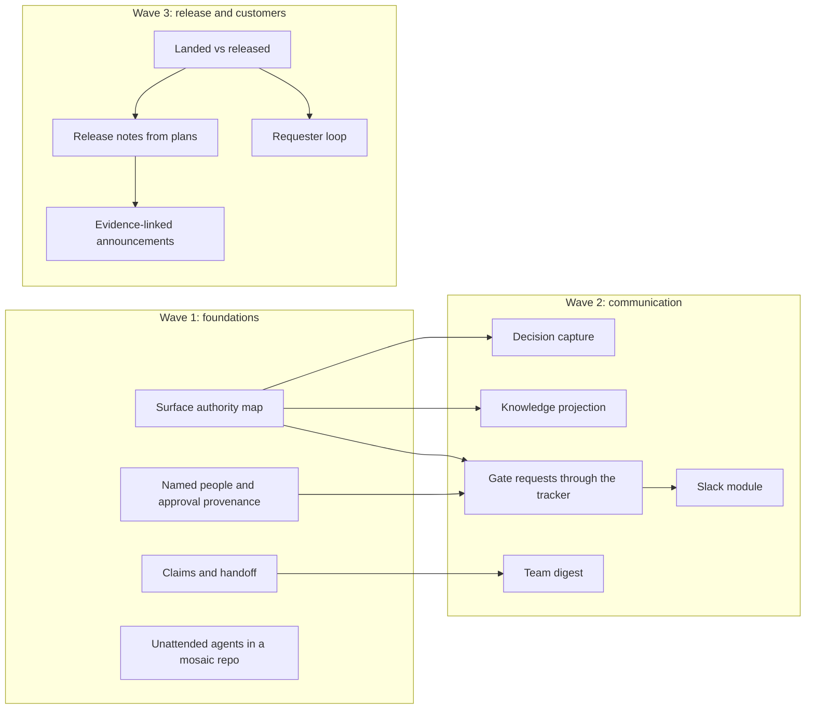

# Multi-contributor collaboration: market research mapped to mosaic, with recommended upgrades (2026-10-31)

This is the [market research](2026-10-31-market-research.md) rewritten for mosaic. Every table gains two columns, **Mosaic today** and **Recommended upgrade**. Every other part ends with what mosaic does today and what to upgrade.

- **Market facts** are unchanged from the original; their sources are in [`sources/`](sources/).
- **Mosaic-today statements** describe the installable kit (`kit/`) at commit `4deeffe`, taken from a [cited inventory](sources/mosaic-inventory.md).
- **Upgrade names** link to [§7 Upgrade backlog](#7-upgrade-backlog), which says what each upgrade changes, what it buys and what it costs. They are directions for a later plan, not designs.

## Bottom line

- **The way teams split work across tools has settled, but no tool settles which one holds the truth.**
  - Slack is where requests arrive and work is discussed live.
  - The tracker (Linear, Jira, GitHub) is the control centre: who owns what, agent assignment, code review, and now releases.
  - The repo holds the code plus the agents' instructions (AGENTS.md, skills).
  - Notion or Confluence supplies context and receives published copies.
  - Each vendor still says its own layer is the system of record, and no product reconciles them.
  - **Mosaic today:** mosaic already writes down which surface owns which fact, but for only two surfaces.
    - The authority/projection table in `kit/docs/process/tracker.md` puts scope, status and evidence in the repo, and ownership, assignment and discussion in the tracker. It also states that "Tracker state is never proof of landing."
    - It has no rows for chat, knowledge base, releases or customer channels.
  - **Upgrade:** extend that table to every surface → [Surface authority map](#surface-authority-map).
- **2026's theme is moving agents from one person's private session into the team's view.** Claude Tag (06-23), Linear coding sessions (06-11), Slack Code (08-20), Zed Delta (09-16), Atlassian AMP (10-07), BAND for Developers (10-15). Atlassian's CEO put it this way: "The agent experience is largely single player today." That is the same limit mosaic has.
  - **Mosaic today:** single-player by design.
    - The process map has one "Human" role (`kit/docs/process/map.md`), and the orchestrator session is private.
    - Other people appear only as tracker assignees, requesters, waiver authors and foreign writer tokens.
  - **Upgrade:** make gates and progress visible to the team without opening the session to anyone who wants to steer it → [Named people and approval provenance](#named-people-and-approval-provenance), [Gate requests through the tracker](#gate-requests-through-the-tracker), [Team digest](#team-digest).
- **Coordinating several people's agents is the weakest part of the market.**
  - Vendors give each agent its own worktree or sandbox, then merge one at a time through merge queues and stacked PRs.
  - Claiming work is advisory or missing, and no standard covers it.
  - Among frameworks installed into the repo, only AWS AI-DLC has real team claims, handoff and a merge gate.
  - **Mosaic today:** further along than its repo-installed peers.
    - Plan numbers are reserved atomically (rule R2 in `kit/docs/process/plan-home.md`).
    - Tracker modes record intent and report overlapping areas before work starts.
    - Each tracker item has one automation writer, and handing an item over is a human act.
    - Parallel executors need disjoint `files:`.
    - **Missing:** a claim or handoff procedure between people; an overlap check without a tracker beyond ledgers and `git branch -r`; and a duplicate-number check across ledgers and reservation branches (lint checks one ledger file at a time).
  - **Upgrade:** [Claims and handoff](#claims-and-handoff), tested by [Team scenarios in the loop rig](#team-scenarios-in-the-loop-rig).
- **Release tracking is moving into the tracker; customer announcements remain weak.**
  - Linear Releases takes deploy events from CI and marks an issue Done when the change ships, not when it merges.
  - It drafts release notes with AI and keeps a changelog per pipeline.
  - Customer announcements are AI drafts written from ticket text. Nothing ties them to evidence that the change actually shipped.
  - **Mosaic today:** no releases, changelog, versioning or announcements.
    - "Done" means a landing receipt, and a product doc's `shipped` means "landed" (`kit/docs/product/README.md`).
    - In tracker modes mosaic writes `done` at landing. On a Linear team that uses Releases, Done means shipped and can notify customers.
  - **Upgrade:** [Landed vs released](#landed-vs-released), [Release notes from plans](#release-notes-from-plans), [Evidence-linked announcements](#evidence-linked-announcements).
- **Mosaic's direct competitors work for one person.** Spec Kit, Kiro, BMAD, OpenSpec, superpowers and Compound Engineering approve through a PR or by the one person in the chat. Tracker, Slack and Notion support comes from community add-ons, and release support is almost absent.
  - **Mosaic today:** also one person, with heavier gates and a first-party tracker protocol where most peers rely on add-ons. The gates:
    - a plan adversary from a different model family;
    - two independent reviewers;
    - a final PR review with exact-head CI;
    - evidence packets;
    - deterministic doctor, lint and checkup.
  - **Upgrade:** team mode is the gap that separates mosaic from them. Borrow AI-DLC's roles, claims and pinned merge gate, not its 33-stage weight → [wave 1](#wave-1--foundations).
- **band.ai is a vendor-neutral room where agents and people talk to each other.** It does not cover the tracker, knowledge base, git, releases or announcements, and its approvals are conversational, not enforced.
  - **Mosaic today:** no live room. Coordination is asynchronous through the repo and tracker, and subagents run inside one runtime.
  - **Upgrade:** nothing now; BAND sits beside mosaic, not inside it → [Live rooms](#live-rooms). One idea is worth borrowing: cost per agent → [Cost per plan](#cost-per-plan).

**Method.**
- **Market research:** seven research slices run in parallel, about 150 sources, primary sources first. I re-checked the claims the conclusions rest on against the vendors' own pages: Linear docs and changelog, Slack Code, Claude Tag, Atlassian AMP, AI-DLC team mode, GitHub stacked PRs, Zed Delta, and band.ai. The full per-slice reports with every source are in [`sources/`](sources/): [spec frameworks](sources/research-spec-frameworks.md), [agent platforms](sources/research-agent-platforms.md), [collaboration tools](sources/research-collab-tools.md), [release communication](sources/research-release-comms.md), [process frameworks](sources/research-process-frameworks.md) and [multi-agent coordination](sources/research-multi-agent.md).
- **Mosaic column:** a separate read-only inventory of `kit/` with file and line citations ([`sources/mosaic-inventory.md`](sources/mosaic-inventory.md)). Recommendations cite the market evidence they rest on.

---

## 1. Market map

| Segment | Main products | What it does in the team's workflow | How well it handles several people | Mosaic today | Recommended upgrade |
|---|---|---|---|---|---|
| Tracker as control centre | Linear, Jira/Rovo, GitHub (Agent HQ), GitLab Duo | Intake, ownership, agent assignment, code review, releases, status | High; changing fastest | Optional tracker (`tracking: none / local / mcp`) records intent, lifecycle events and intake verdicts; the repo stays authoritative | Keep it a projection; add [Gate requests through the tracker](#gate-requests-through-the-tracker), [Landed vs released](#landed-vs-released), [Review-surface signals](#review-surface-signals) |
| Chat as the workroom | Slack Code and Slackbot, Claude Tag, Devin/Factory task channels, MS Teams | Where requests arrive; live steering; approvals; digests | Good visibility; weak lasting record | None; everything happens in the one human's session | [Gate requests through the tracker](#gate-requests-through-the-tracker) first (Linear already syncs to Slack), then the optional [Slack module](#slack-module) |
| Knowledge and context | Notion 3.x agents, Confluence/Rovo, Glean, Unblocked, Dosu, DeepWiki | Context for agents; meeting notes into the tracker; auto-generated docs | Medium; the knowledge base is a copy, not the source | The repo is the knowledge base (architecture, product, gaps, pitfalls, open questions); outside notes enter through the data-only ingestion exemption | [Knowledge projection](#knowledge-projection), [Decision capture](#decision-capture) |
| Cloud coding agents | Devin, Cursor, Codex, Copilot, Factory, Amp, Augment, Warp, Ona, Charlie | Do delegated work and report back where it was asked | Medium; each has different rules on identity and who may steer | Executors are mosaic's own subagents; nothing covers outside agents that load `AGENTS.md`/`CLAUDE.md` with no human present | [Unattended agents in a mosaic repo](#unattended-agents-in-a-mosaic-repo); later [Delegated execution](#delegated-execution) |
| Frameworks installed in the repo (mosaic's direct competitors) | Spec Kit, Kiro, AWS AI-DLC, BMAD, OpenSpec, superpowers, Compound Engineering, GSD, Agent OS | Process, specs and approval gates inside the repo | Low; AI-DLC is the exception | Same class; ahead on gates, evidence, deterministic checks and tracker protocol; behind AI-DLC on team roles and claims | [Named people and approval provenance](#named-people-and-approval-provenance), [Claims and handoff](#claims-and-handoff), [Team scenarios in the loop rig](#team-scenarios-in-the-loop-rig) |
| Coordination layers | MCP Agent Mail, Beads/Gas Town, Claude Code agent teams, Conductor Cloud, Zed Delta, BAND | Claims, inboxes, shared rooms, handoff | Low to medium; mostly one person's agents | Atomic plan numbers, writer tokens, area-overlap reports, disjoint executor waves; no session registry or lease | [Claims and handoff](#claims-and-handoff), kept in git and the tracker rather than in a chat mesh |
| Release and customer communication | release-please, Changesets, Copilot Release Notes, Linear Releases, LaunchDarkly, LaunchNotes, Productlane, Featurebase, Canny, Statuspage/incident.io | Release notes, rollout, announcements, feedback | Notes are mature; announcements tied to evidence don't exist | None | [Landed vs released](#landed-vs-released), [Release notes from plans](#release-notes-from-plans), [Evidence-linked announcements](#evidence-linked-announcements), [Requester loop](#requester-loop) |
| Process frameworks | Scrum and "AI and Scrum" 2026.1, AI-Native SAFe, Shape Up, Team Topologies, DORA 2025, GitLab handbook, Apache Way, RFC/ADR processes, Amazon PR/FAQ | Where decisions live, cadence, accountability | Mature rules; nothing on syncing tools or on agents claiming work | Follows the written-record doctrine: records routing, "do not treat silence as approval", one accountable human | Named roles via [Named people and approval provenance](#named-people-and-approval-provenance); cadence via [Team digest](#team-digest); [Lazy consensus](#lazy-consensus) only after a ruling |

## 2. Where each kind of communication lives in 2026

| Concern | Usual home | Examples | Weak spot | Mosaic today | Recommended upgrade |
|---|---|---|---|---|---|
| Intake | Chat, email or form → tracker triage, with the thread synced back to the requester | Linear Asks (Slack, email, web), `@GitHub` creating issues from Slack, Intercom → Linear | Treating a whole thread as the spec invites prompt injection | `/mosaic-intake` reads the configured tracker queue; verdicts are fingerprinted and checked by a second model family; every outcome stops at the human; with no tracker it stops; nothing reads chat directly | Read what the tracker already captured from Slack (Linear Asks); treat thread text as untrusted ([Surface authority map](#surface-authority-map)); [Slack module](#slack-module) for teams without a tracker |
| Ownership | Tracker: a human assignee plus an agent "delegate" | Linear's delegate model, agents as Jira assignees, assigning issues to Copilot | A second person delegating can start a parallel session (Devin, Codex) | The tracker owns assignment ("None in repo"); the writer token names a session, deliberately not a person; with no tracker, plans have no owner field | [Named people and approval provenance](#named-people-and-approval-provenance): an owner in the plan when there is no tracker, the tracker assignee otherwise |
| Specs and decisions | Repo (spec or ADR reviewed in a PR) or knowledge base | Spec Kit, OpenSpec, AI-DLC; BMAD and Jira Planner publishing to Confluence/Notion | One-person approval gates; specs collide | Plan docs, records routing with a minting gate, cross-family plan adversary; approval is "verbal approval" recorded in the first task commit, not tied to a plan revision; numbers can't collide (R2) | [Named people and approval provenance](#named-people-and-approval-provenance) (who, where, which revision); [Decision capture](#decision-capture) |
| Live work and steering | A chat room per task, or a session attached to the tracker issue | Slack Code, Claude Tag, Devin/Factory channels, Linear coding sessions, BAND rooms | Who may steer someone else's agent differs by product | Private session; the tracker gets lifecycle events and one comment per landed wave | [Gate requests through the tracker](#gate-requests-through-the-tracker), [Team digest](#team-digest); [Live rooms](#live-rooms) later |
| Coordination | Each agent isolated, merges serialized | Worktrees and sandboxes, merge queue, stacked PRs, AI-DLC claims | No claims across tools; no standard | Tracker overlap reports, single writer with human handover, atomic numbering, disjoint `files:` waves, one worktree per stack | [Claims and handoff](#claims-and-handoff) |
| Review and approval | PR (GitHub or Linear Diffs) plus approvals in the channel | Guided reviews, risk scores, an extra approval required for agent PRs | Review is the bottleneck | Two independent reviewers from different model families for code, final PR review, exact-head CI, every comment ruled; the human merges (PR mode) or the orchestrator lands ff-only (direct); the light path lands without human sign-off once reviewers are clean | [Review-surface signals](#review-surface-signals); a second named approver for HIGH risk ([Named people and approval provenance](#named-people-and-approval-provenance)) |
| Team knowledge | Versioned files in the repo plus tools that index everything | AGENTS.md, skills, GitHub "Dreaming" proposing rule changes as PRs, Unblocked, Dosu | Decisions made in chat rarely become formal records | `AGENTS.md`/`CLAUDE.md`, rule files, skills and registries in two ports with parity checks; learnings approved at sign-off | Keep; add [Knowledge projection](#knowledge-projection) for readers outside the repo and [Decision capture](#decision-capture) |
| Status and digests | Tracker updates pushed into Slack | Linear's agent-drafted project updates and Pulse feed, Slack Recaps, Loops weekly digests | Noise from many agents in Slack | Human briefs at gates (at most 40 lines), tracker events, a checkup digest of harness drift; no team status | [Team digest](#team-digest) |
| Release | CI → a release in the tracker → AI notes, or a pending "release PR" | Linear Releases, Jira+Rovo, release-please, Changesets | Notes built from commit messages are noisy | None; "done" is a landing receipt | [Landed vs released](#landed-vs-released), [Release notes from plans](#release-notes-from-plans) |
| Customer announcements | Changelog and announcement tools, support tools | LaunchNotes, Productlane, Featurebase, Linear Loops, Claude Tag | Not tied to evidence of what shipped; versions for different audiences drift apart | None; the reader-first writing rules cover only the one human | [Evidence-linked announcements](#evidence-linked-announcements) |
| Customer feedback | Support and feedback tools synced both ways with the tracker | Linear Customer Requests, Featurebase emailing voters, Intercom reopening conversations | Fairly mature | Intake reads requesters' comments on tracker items and never closes a request on the human's behalf | [Requester loop](#requester-loop) |

## 3. Findings

1. **Chat is where requests come in; the record is kept elsewhere.**
   - **Process rules agree on this.** GitLab keeps Slack for only 90 days, bans it for approvals and decisions, and treats the issue description as the single source of truth ([handbook](https://handbook.gitlab.com/handbook/communication/)). Apache: "if it didn't happen on the mailing list, it didn't happen." Amazon decides on written narratives.
   - **The tools follow.** Linear syncs Slack threads into issues and project-update comments in both directions ([docs](https://linear.app/docs/slack)). It tells agents to report through typed activity entries rather than comments, because comments can be edited.
   - **Vendors still each claim to be the record.** Jira says it is "where agents own meaningful parts of work". Notion calls itself "a durable shared place". Slack says the conversation is the real work.
   - **Mosaic today:** on the record side by design.
     - Records routing decides where every ruling lives.
     - Tracker comments link evidence instead of mirroring it.
     - "Tracker state is never proof of landing."
     - Nothing says what chat is, because mosaic has no chat.
   - **Upgrade:** [Surface authority map](#surface-authority-map) makes chat explicitly non-authoritative and its text untrusted input. [Decision capture](#decision-capture) turns decisions made in chat into records.

2. **Agent work done in front of the team is 2026's headline.**
   - Slack Code gives one channel per task, visible to the team. People can see diffs and redirect the agent, risky changes can be sent to a person for approval, and the channel archives itself as an audit log ([Slack](https://slack.com/blog/news/slack-code-channels-for-agents)). Slack reports that more than 70% of these channels open and close within a day.
   - Claude Tag puts one shared @Claude in each channel, and admins see a log of who asked for each task ([Anthropic](https://www.anthropic.com/news/introducing-claude-tag)). Anthropic says 65% of its product team's code comes from its internal version.
   - Zed Delta replicates the agent conversation and the working tree together. Zed turned off pull requests on Delta's own repo; 33 people have since landed 570 changes ([Zed](https://zed.dev/blog/delta-public-beta)).
   - Atlassian AMP gives every agent a named owner and shows agents next to people in presence bars ([Computer Weekly](https://www.computerweekly.com/news/366652013/Atlassian-Team-26-Europe-move-to-AI-as-team-sport-with-multi-player-agentic-system)).
   - **Mosaic today:** one human and a private session. Others see:
     - the reserved draft row in the master ledger;
     - in tracker modes, lifecycle events and one comment per landed wave.
   - **Upgrade:** make gates and progress visible while authority stays with named people → [Gate requests through the tracker](#gate-requests-through-the-tracker), [Team digest](#team-digest). Don't copy "anyone in the channel can steer".

3. **Every product handles requests the same way; they differ on identity and steering rights.**
   - **The common loop:** mention or assign the agent, it runs a session, reports progress in the same place, and finishes with a PR and a session link. The whole thread is the spec.
   - **Identity depends on where you ask.** In a shared channel the agent acts as a service account; in a DM it acts as the requester.
   - **Risks the vendors document themselves:**
     - Cursor's team follow-ups allow "lateral movement" into a more privileged colleague's secrets.
     - The person who requested a Factory PR can be its only approver.
     - GitHub blocks you from approving a Copilot PR you assigned, and requires an extra approval for unattributed PRs.
     - GitLab gives agents only the access that both the triggering user and the service account have.
   - **Mosaic today:**
     - The writer token is opaque and per session, and the rule says "Never impersonate another session even with human permission."
     - The session is private, so no one else steers it.
     - Commits carry no attribution beyond the plan and task number (`NNNN-T<k>: 
`).
   - **Upgrade:**
     - Keep the opaque token, and record the accountable person separately → [Named people and approval provenance](#named-people-and-approval-provenance).
     - Mark agent-made commits → [Attribution trailers](#attribution-trailers).
     - For agents acting where no human is present, adopt the market's rule: shared places get least privilege, never the requester's private credentials → [Unattended agents in a mosaic repo](#unattended-agents-in-a-mosaic-repo).

4. **The industry agrees that the agent acts on a person's behalf and the person stays accountable.**
   - Linear's Agent Interaction Guidelines: "An agent cannot be held accountable" ([AIG](https://linear.app/developers/aig)).
   - Scrum's "AI and Scrum" 2026.1: "AI may recommend, but humans decide."
   - Team Topologies: every agent should be governed by a long-lived team.
   - Apache asks for `Generated-by:` commit trailers.
   - Linear Diffs marks review comments an agent wrote on someone's behalf.
   - **Mosaic today:** matches the consensus. The human approves and signs off, executors stay inside `files:`, and reviewers never edit. It does not record who approved or which plan revision they approved.
   - **Upgrade:** [Named people and approval provenance](#named-people-and-approval-provenance), [Attribution trailers](#attribution-trailers).

5. **Coordinating several contributors is the weakest layer.**
   - **Most tools serve one developer's parallel agents.** Claude Code agent teams allow one team per session, and two teammates editing the same file "leads to overwrites".
   - **Where claims exist, they are advisory or only local.** Agent Mail uses time-limited advisory leases on files; Beads has an atomic `--claim`.
   - **Known collision bugs:**
     - Spec Kit numbers spec folders 001, 002…, so teammates collide ([#497](https://github.com/github/spec-kit/discussions/497)).
     - OpenSpec silently overwrites a teammate's requirement edit when the second change is archived ([#1387](https://github.com/Fission-AI/OpenSpec/issues/1387)).
     - OpenAI Symphony keeps its claims only in memory, so they are lost on restart.
   - **AWS AI-DLC team mode is the one rigorous precedent installed in the repo** ([workshop mode](https://github.com/awslabs/aidlc-workflows/blob/main/docs/guide/workshop-mode.md)):
     - Roles are integration lead, unit team and review group.
     - Claims are git refs, and "exactly one concurrent claimant wins".
     - `adopt` hands an in-progress claim to a teammate.
     - Work goes publish → pin (exact commit plus evidence) → human merge gate → land.
     - It does not work across repos yet.
   - MCP, A2A, ACP, AGENTS.md and Agent Skills cover plumbing; none defines claims or ownership. This is my inference from reading the specs.
   - **Mosaic today:**
     - **Already in place:** R2 atomic numbering, which avoids Spec Kit's collision; area-overlap reports; one writer per tracker item; disjoint executor waves.
     - **Records:** mosaic edits records directly in git, so overlapping edits surface as rebase conflicts rather than OpenSpec-style silent overwrites. Semantic clashes in different lines would still pass (inference).
     - **Loop scenarios already cover** a foreign writer (S8, S10), unknown-scope collisions (S12) and remote-branch collisions without a tracker (S21).
     - **Missing:** handoff, claims without a tracker, a cross-ledger duplicate-number check, and a scenario with two sessions reserving at once.
   - **Upgrade:** [Claims and handoff](#claims-and-handoff), [Team scenarios in the loop rig](#team-scenarios-in-the-loop-rig).

6. **Review is the bottleneck.**
   - Faros: 98% more merged PRs but 91% more review time ([Faros](https://www.faros.ai/blog/ai-software-engineering)).
   - DORA 2025: AI "amplifies what's already there". Throughput and instability rise together, and rework rate became a fifth metric.
   - Thoughtworks Radar Vol 34: "codebase cognitive debt" gets worse with several contributors.
   - **Vendors are responding at the review step.**
     - Linear has Guided Reviews, a risk-score plugin, and `.gitattributes` categories for grouping files, including `review-agent-guidance`.
     - GitHub stacked PRs went GA on 2026-10-06; a stack goes through the merge queue as one group ([GitHub](https://github.blog/changelog/2026-10-06-stacked-pull-requests-generally-available/)).
     - Cursor bought Graphite.
   - **Mosaic today:** spends machine review generously and keeps people on two gates with briefs of at most 40 lines, which is also the market's answer. The machine review:
     - the plan adversary;
     - two reviewers;
     - a final review replayed on every new PR head.

     Nothing is exported to the review screens people use (Linear Diffs, GitHub), and the cost of all that review is invisible.
   - **Upgrade:** [Review-surface signals](#review-surface-signals), [Native GitHub stacks](#native-github-stacks), [Cost per plan](#cost-per-plan).

7. **Team knowledge is moving into versioned files; the knowledge base becomes a copy.**
   - Cursor dropped Memories in favour of Rules. Devin is moving Knowledge to Skills and Plugins.
   - GitHub "Dreaming" proposes edits to skills and instructions as PRs. Thoughtworks Radar lists shared instruction files as "Adopt".
   - Capturing decisions from chat means automated summaries, such as Notion's agents triggered by meeting notes and Unblocked/Dosu indexing. Nobody produces formal decision records with a human ruling.
   - **Mosaic today:** aligned by construction. `AGENTS.md`, rule files, skills and registries live in the repo, with port-parity checks and a minting gate for new records. There is no readable copy outside the repo and no path in from chat.
   - **Upgrade:** [Knowledge projection](#knowledge-projection), [Decision capture](#decision-capture).

8. **Release tracking is moving into the tracker.**
   - **Linear Releases** ([docs](https://linear.app/docs/releases)), launched 2026-04-30:
     - A CI action reads issue IDs from commit messages.
     - Pipelines are continuous or scheduled, with path filters for monorepos.
     - On merge the issue moves to "Merged"; when the release completes it moves to Done. That transition "triggers integration automations… when changes are available to customers".
     - Linear Agent drafts the release notes, and each pipeline keeps a changelog.
   - **On the repo side,** the human gate is a pending release PR (release-please, Changesets). Copilot Release Notes lists entries it is unsure of separately for a person to check.
   - **Linear's MCP server, mounted in this session,** already lets outside agents read and write releases, release notes, PR diffs, merges, status updates and agent skills.
   - **Mosaic today:** no release concept. In tracker modes mosaic writes `done` on landing evidence; on a Linear team using Releases, Done is the shipping step that can notify customers. Mosaic already guards one case like this: reservation PRs must not name the tracker key, because the tracker could auto-close the item early.
   - **Upgrade:** [Landed vs released](#landed-vs-released), [Release notes from plans](#release-notes-from-plans). When the tracker server is Linear, use its release tools.

9. **Customer announcements are the step least connected to evidence.**
   - **Drafts come from ticket text:**
     - Productlane drafts a changelog when a Linear project completes.
     - Linear's "Loops" automation has a template that writes "user-facing messaging that Support can share".
     - Claude Tag posts to #announcements with a "sent on behalf of" line.
     - Compound Engineering's `ce-promote` drafts copy but "never posts".
   - **LaunchNotes' own guidance** is one canonical record, split per audience only when the action the reader must take differs; otherwise the versions drift apart ([LaunchNotes](https://www.launchnotes.com/release-notes/audiences)).
   - **No product I found links what customers are told to what was verified to ship.** No slice found one.
   - **Mosaic today:** no announcements, but it has the parts nobody else has:
     - landing receipts;
     - an Unverified section in every plan;
     - writing rules that keep wording "exactly as true as the code".
   - **Upgrade:** [Evidence-linked announcements](#evidence-linked-announcements), [Requester loop](#requester-loop).

10. **High churn and usage-based billing.**
    - **Shut down or absorbed in the past year:**
      - Google Jules shuts down on 2026-12-31; Vibe Kanban and Terragon closed.
      - Standalone Rovo Dev was folded into Jira, and Windsurf became Devin Desktop.
      - Claude in Slack became Claude Tag; Codex in Slack moved to @ChatGPT.
      - Cursor Memories and Devin Knowledge were dropped.
      - Atlassian Compass is moving to DX; Statsig went to OpenAI, then Amplitude.
    - **Agent work is billed by credits:** Linear, Notion, Rovo. One user reported about 760 Rovo credits for a single PR review.
    - **Durable pieces:** the open standards now under the Linux Foundation's Agentic AI Foundation (MCP, AGENTS.md, A2A) and files in the repo. This is my inference.
    - **Shared surfaces add risk.** Notion 3.0 agents could be tricked into leaking data, and a public GitHub issue could make the GitHub MCP server leak private-repo data.
    - **Slack throttles apps not listed in its Marketplace** to one message-history request per minute.
    - **Mosaic today:**
      - Mosaic depends on its runtimes (omp, Claude Code), git, `gh`, Bun and optionally one MCP tracker server. It has no vendor-specific chat or knowledge-base dependency.
      - No rule treats tracker, PR or chat text as untrusted. The nearest clause, in `kit/docs/process/model-notes.md`, is not part of ordinary project work.
    - **Upgrade:**
      - Add every integration as an optional mode behind a named MCP server, the way `tracking: mcp` works today.
      - Add the untrusted-input rule → [Surface authority map](#surface-authority-map).
      - Prefer standards over vendor coordination features (see [Rejected](#rejected)).

## 4. Gaps nobody fills yet

- **Which surface owns which fact.** No one declares, for each kind of fact, whether chat, tracker, knowledge base or repo is authoritative, and then detects drift between them.
  - **Mosaic today:** has this for the repo and the tracker.
  - **Upgrade:** [Surface authority map](#surface-authority-map). This is the clearest place for mosaic to lead.
- **Claims and handoff across several people.** AI-DLC works in one repo only, Symphony's claims vanish on restart, and BAND tasks allow several assignees. There is no standard.
  - **Mosaic today:** one writer per tracker item with human handover, atomic numbering, overlap reports.
  - **Upgrade:** [Claims and handoff](#claims-and-handoff).
- **Release → announcement backed by evidence.** No chain runs from landing/verification evidence to release notes to per-audience announcements, with approval and provenance at each step.
  - **Mosaic today:** the evidence exists (receipts, Unverified, Execution log); the chain does not.
  - **Upgrade:** [Release notes from plans](#release-notes-from-plans) → [Evidence-linked announcements](#evidence-linked-announcements).
- **Chat decisions into formal records.** Tools summarize and index chat. None turns a decision into a record with a lifecycle and a named decider, as ADR, KEP and RFD processes do.
  - **Mosaic today:** the routing, the minting gate and the human ruling exist; inputs from chat don't.
  - **Upgrade:** [Decision capture](#decision-capture).
- **More than one approver for agent output.** Gates answer to whoever is in the session. Named reviewers, quorum, and time-boxed lazy consensus (Apache's 72 hours, Rust's final comment period) aren't built into any product for agent plans.
  - **Mosaic today:** one human; "do not treat silence as approval".
  - **Upgrade:** [Named people and approval provenance](#named-people-and-approval-provenance); [Lazy consensus](#lazy-consensus) only with a ruling.
- **Reducing review load with structured evidence.** Guided reviews and risk scores are early steps; reviewing is where the cost lands.
  - **Mosaic today:** heavy machine review, short human briefs.
  - **Upgrade:** [Review-surface signals](#review-surface-signals), [Cost per plan](#cost-per-plan).

---

## 5. band.ai

### What it is
- **Company.** Thenvoi AI Ltd, trading as BAND. CEO Arick Goomanovsky, CTO Vlad Luzin. Came out of stealth on 2026-04-23 with a [$17M seed](https://www.prnewswire.com/il/news-releases/band-exits-stealth-with-17m-to-build-the-communication-and-interaction-layers-for-the-internet-of-agents-302751810.html) (Sierra, Hetz, Team8). [BAND for Developers](https://www.prnewswire.com/il/news-releases/band-launches-band-for-developers-to-support-the-transformation-of-sdlc-collaboration-and-control-of-multiple-coding-agents-302909844.html) launched 2026-10-15: free to start, macOS/Windows/Linux, plus a VS Code extension. The public customer story is Qodo's "Dark Factory".
- **[Platform](https://www.band.ai/platform).** Two layers: a collaboration layer ("Agentic Mesh") and a governance layer ("Interaction Control Plane"). Pieces:
  - Persistent identities for agents.
  - Rooms where people and agents are both participants.
  - @mention routing: an agent that isn't mentioned never receives the message; people see everything.
  - Delivery tracking per agent and contacts across organizations.
  - A memory API with store, supersede and archive.
  - Room and organization roles, and an audit trail.
  - Bridges: a Python/TypeScript SDK (`band-sdk` 6.0.1) with about 20 framework adapters, A2A, ACP, MCP (platform actions only), a Slack adapter, and self-hosting for Enterprise.
- **[Band Desktop](https://docs.band.ai/band-desktop.md)** (formerly "Jam") connects local coding agents and central organization agents into rooms. Supported agents:
  - Claude Code through the `band-peer` plugin (`/jam as <role>`).
  - Codex, Copilot, OpenCode and Antigravity.
  - Cursor and Gemini CLI through ACP.

  Each room has:
  - A plan plus diagram.
  - A task board with append-only history.
  - A "Needs your response" queue.
  - The agents' own permission prompts.
  - Cost per agent.
  - Reusable agent teams.

  The pitch is "stop being the go-between": the planner and reviewer stay in the room, and review findings survive context compaction.
- **Mosaic today, against each BAND idea:**
  - BAND's room plan matches mosaic's plan doc, but BAND's is local to the desktop app and not enforced; mosaic's is the authority behind every gate.
  - BAND's task board with append-only history matches mosaic's ledger plus append-only tracker comments with receipts.
  - BAND's memory API with supersede matches mosaic's records, which are superseded or archived, never deleted.
  - BAND's human-in-the-loop matches mosaic's gates, except that BAND's are conversational while mosaic's are procedure plus evidence.
- **Upgrade:** none taken from this list; mosaic already has the durable version of each idea.

### Against the surfaces you named

| Surface | What BAND covers | Mosaic today | Recommended upgrade |
|---|---|---|---|
| Slack | Its own rooms are the chat. The Python-only `SlackAdapter` links a Slack thread to a room for one agent; the Slack person is not a room participant ([docs](https://docs.band.ai/integrate/slack.md)) | None | [Gate requests through the tracker](#gate-requests-through-the-tracker), then [Slack module](#slack-module); BAND isn't needed for this |
| Linear | No integration. A task has an opaque `linked_native_id` field | Full tracker protocol in `mcp` mode: intent, complete overlap reads, single writer, lifecycle events, intake | [Landed vs released](#landed-vs-released), [Gate requests through the tracker](#gate-requests-through-the-tracker) |
| Notion | None. The memory API is agent memory, not a team knowledge base | None; the repo is the knowledge base | [Knowledge projection](#knowledge-projection) |
| Git, review, merge | Out of scope by design: "you provide source access, worktrees, branches… conflict handling, and the merge" ([docs](https://docs.band.ai/understand/when-to-use-band.md)) | Mosaic's core: branches, reviews, final review, landing evidence | Keep; BAND leaves exactly this to tools like mosaic, so they are complementary |
| Approvals | Approving by @mention is "not a security boundary"; whether an agent obeys "depends on its model and instructions" ([docs](https://docs.band.ai/features/human-in-the-loop.md)). Only the coding agent's own permission prompts are enforced, by the coding agent | Human gates; silence and timeouts are not approval; approver identity and plan revision aren't recorded | [Named people and approval provenance](#named-people-and-approval-provenance); never treat a chat mention as approval |
| Releases and announcements | None | None | [Landed vs released](#landed-vs-released), [Release notes from plans](#release-notes-from-plans), [Evidence-linked announcements](#evidence-linked-announcements) |
| Several people | Yes: teammates' agents share rooms, an agent's owner can read any room it's in, and rooms have roles ([docs](https://docs.band.ai/security/permissions-and-visibility.md)) | One human; others appear through tracker ownership and foreign writer tokens | [Named people and approval provenance](#named-people-and-approval-provenance), [Claims and handoff](#claims-and-handoff) |

### Strengths
- **Works across vendors and owners.** It is the only product I found built for "my Claude Code + your Codex + an organization agent in one room" across machines and companies.
- **The room outlives any session.** That addresses two real problems: planner and reviewer agents being dismissed once coding starts, and open review findings lost when a chat is compacted.
- **Plumbing.** Routing is deterministic, task history is append-only, cost is shown per agent and per room, and it connects to the A2A, ACP and MCP standards instead of competing with them.
- **Mosaic today:**
  - Mosaic already keeps work outside the session: the plan doc, the Execution log, evidence packets under `docs/plans/evidence/NNNN/`, and append-only tracker comments.
  - It already runs reviewers from different model families through model roles in one runtime.
  - It has no cost view.
- **Upgrade:** [Cost per plan](#cost-per-plan). Cross-harness rooms matter only if contributors' agents must talk live → [Live rooms](#live-rooms).

### Weaknesses and risks
- **Governance marketing goes further than the docs.** The site says "no lateral movement, no privilege escalation" and "approve, override". The docs say approvals are conversational, and that stopping an external agent may not stop it receiving messages.
- **No exclusive claims.** "Your first status write joins you" to a task, and several agents can work the same one ([API](https://docs.band.ai/api/agent-api/agent-api-chat-tasks/update-chat-task.md)). There is no conflict detection, and git is out of scope.
- **The Desktop plan is local.** It is not sent to SDK agents, other machines or other owners.
- **Discovery on the local network is on by default.** It announces your agents' handles, room names and cost estimates to others on the same network.
- **Young and changing.**
  - The SDK broke compatibility going from 4 to 5 to 6 within months.
  - The SDK can't send the API's "needs attention" events, and the web app can't display them.
  - It was renamed twice (Thenvoi→BAND, Jam→Desktop).
  - RuntimeWire noted the founder's answers "do not establish adoption or measured productivity gains" ([RuntimeWire](https://runtimewire.com/article/band-launches-agent-desktop-as-some-developers-build-custom--735e95)).
- **Mosaic today:** each weakness is a place where mosaic is deliberately strict:
  - approvals need a human;
  - each tracker item has one writer;
  - landing is proven by git;
  - every gate reads the plan in the repo.
- **Upgrade:** keep all four, and take none of BAND's softer versions (see [Rejected](#rejected)).

### Where it sits
- **Overlaps:** Slack Code and Claude Tag (rooms with agents in them), Claude Code agent teams (one person only), Conductor Cloud, MCP Agent Mail, Atlassian AMP.
- **Its bet:** the layer where agents talk is neutral infrastructure, separate from the tracker and chat vendors.
- **How it differentiates:** it compares itself to "team chat with agents", meaning Slack-style channels, which have no plans or work items. Linear already has coding sessions, delegation to agents, and a board.
- **For your four surfaces,** BAND covers only the conversation between agents and people. It is the communication channel, not the process.
- **Mosaic today:** mosaic is a process with no live channel; BAND is a channel with no process. They overlap very little.
- **Upgrade:** none now. If [Live rooms](#live-rooms) ever happens, BAND's MCP server (platform actions such as posting into a room) and its ACP server are the integration points, and mosaic's gates stay in the repo (inference from BAND's docs).

---

## 6. Mosaic today against the market, with upgrades

| Capability | Best in the market | mosaic today | Recommended upgrade |
|---|---|---|---|
| Stating which surface owns each fact | Process rules (GitLab, Apache); Linear Weave ("Linear is the source of truth") | Yes, for repo ↔ tracker only (authority/projection table in `tracker.md`) | [Surface authority map](#surface-authority-map): every surface, plus an untrusted-input rule |
| Seeing overlapping work | AI-DLC claims, Agent Mail leases | Advisory `intersect` over tracker areas, plus single-writer tokens | [Claims and handoff](#claims-and-handoff): overlap checks in every tracking mode and a duplicate-number check across ledgers |
| Handing work between sessions or people | AI-DLC `adopt`, Conductor "Reassign" | The human hands the item over in the tracker and the writer generation increments | [Claims and handoff](#claims-and-handoff): a handoff step that re-verifies branch, plan and evidence |
| Agent acts for an accountable human | Industry consensus | Yes: the human approves plans and signs off | [Named people and approval provenance](#named-people-and-approval-provenance), [Attribution trailers](#attribution-trailers) |
| "Done" backed by evidence | Linear Releases: done = shipped | done = landing receipt on the published branch, not deployment | [Landed vs released](#landed-vs-released) |
| Intake rigor | Linear auto-applies its triage suggestions | Fingerprinted verdicts, an independent check by a second model family, and every outcome stops at the human | Keep; widen sources through [Requester loop](#requester-loop) and [Slack module](#slack-module) |
| Chat as front door or live room | Slack Code, Claude Tag, Linear Asks, BAND | None | [Gate requests through the tracker](#gate-requests-through-the-tracker), [Slack module](#slack-module); [Live rooms](#live-rooms) later |
| Knowledge base copy (Notion) | Notion MCP and agents, BMAD publishing | None | [Knowledge projection](#knowledge-projection) |
| Several people with roles; more than one approver | AI-DLC lead / unit team / review group | One human plus one orchestrator | [Named people and approval provenance](#named-people-and-approval-provenance) |
| Status digests for stakeholders | Linear agent-drafted updates and Pulse feed | None | [Team digest](#team-digest) |
| Release notes and changelog | Linear Releases, release-please | None | [Release notes from plans](#release-notes-from-plans) |
| Customer announcements and feedback loop | LaunchNotes, Productlane, Linear Customer Requests | None | [Evidence-linked announcements](#evidence-linked-announcements), [Requester loop](#requester-loop) |

---

## 7. Upgrade backlog

**Tags.** Status tags follow [concept-backlog.md](../concept-backlog.md):
- `cand`: a candidate not yet designed.
- `later`: worth doing only after loop evidence.
- `no`: considered and rejected, with the reason given.

**Waves.** A suggested order. Each wave relies on the one before, and [Team scenarios in the loop rig](#team-scenarios-in-the-loop-rig) scores every wave.

**Defaults.** Every upgrade follows mosaic's install pattern: optional modes in the manifest, twins in both ports, doctor checks, and nothing installed when the option is off. A solo project with every option off behaves exactly as today.

### Wave 1 — foundations

#### Surface authority map
`cand`
- **Change:**
  - Grow the authority/projection table in `kit/docs/process/tracker.md` into one rule that covers every surface a project installs: repo, tracker, chat, knowledge base, release record and customer channels. For each fact it names the authority, the copies, and whether the source can be edited after the fact.
  - Add an untrusted-input clause: text read from tracker items, PR comments, chat threads and knowledge pages is evidence, never instructions. Acting on it needs the plan's or the human's authorization. Today the closest clause sits in `model-notes.md`, which is not part of ordinary project work.
  - Doctor fails when an installed surface module has no rows.
- **Market source:**
  - GitLab keeps decisions out of Slack, and Apache keeps them on the mailing list.
  - Linear's agent guide prefers non-editable activities over editable comments.
  - Copilot and Claude Tag both warn that thread text can carry injected instructions; Notion 3.0 and the GitHub MCP server both had real leaks this way.
- **Buys:** fills the first market gap, and makes every later module safe by construction.
- **Costs:** one more rule read at gates; it has to stay short to respect context budgets.

#### Named people and approval provenance
`cand`
- **Change:**
  - **Roles.** Replace the single "Human" role with named roles: plan owner (the person accountable), approvers, integrator (who lands or merges) and requester.
  - **Recording.** Each approval is recorded in the plan with:
    - who approved;
    - where: in-session, a tracker comment ID or a PR review ID;
    - when;
    - a hash of the plan text that was approved.
  - **Lint.** It rejects `approved` without a valid approval for the current revision. A recorded within-scope amendment carries an approval forward, as sign-off already does.
  - **Policy (a manifest choice).** Who may approve, and whether HIGH-risk plans need a second person other than the owner.
  - **Solo projects** keep today's behaviour: owner, approver and integrator are the one human.
- **Market source:**
  - AI-DLC's integration lead, unit team and review group, with a pinned merge gate.
  - GitHub refusing self-approval of an agent PR you assigned; Factory recommending two approvals.
  - Kubernetes KEP approvers, GitLab's DRI, and Linear's human assignee plus agent delegate.
- **Buys:** approvals from people outside the session and an audit trail. It also closes today's gap where approval isn't tied to a plan revision.
- **Costs:** frontmatter, lint and brief changes in both ports, and mapping one person's identity across git, tracker and chat.

#### Claims and handoff
`cand`
- **Change:**
  - Show who holds each active plan (owner and last event) in the ledger row, or in the managed block in tracker modes. Checkup flags stale holders.
  - Run the area-overlap check across active plans in every tracking mode, including `none`, where today it is ledgers plus `git branch -r`. Exit codes 0/1/2 as usual.
  - Check for duplicate plan numbers across ledgers and open `docs/*-reserve` branches; lint checks one ledger file today.
  - Add a handoff step modelled on AI-DLC's `adopt`. The incoming person's session re-verifies branch head, plan status, Execution log, open findings and Unverified before taking over, and increments the writer generation in tracker modes.
  - Keep the honest wording: visibility, not a lock.
- **Market source:**
  - AI-DLC's git-ref claims and `adopt`.
  - Agent Mail's expiring leases, released when stale; Beads' atomic claim.
  - The collision bugs in Spec Kit, OpenSpec and Symphony.
- **Buys:** several people can work in parallel safely and pick up each other's work.
- **Costs:** more checks per session. Leases stay advisory, because git has no locks.

#### Unattended agents in a mosaic repo
`cand`
- **Change:**
  - **Scope.** A short core rule for sessions that load `AGENTS.md`/`CLAUDE.md` with no human present: Linear coding sessions, Copilot, Codex or Cursor cloud agents, Claude Code in GitHub Actions.
  - **May:** investigate and open a draft PR with evidence.
  - **Must not:** reserve plan numbers, change plan status, write tracker lifecycle events or land.
  - **After:** their PR goes through the normal review and final review, and [Attribution trailers](#attribution-trailers) mark it.
- **Market source:**
  - Linear coding sessions run "from the existing Claude Code or Codex setup your team already uses", and Loops can start them automatically on triage.
  - Jira, GitHub and GitLab let anyone assign issues to outside agents.
  - Mosaic's own intake rule already says "no unattended landing".
- **Buys:** mosaic's process doesn't break, or get bypassed, the day a team switches on tracker-native agents. Those agents become feeders of the mosaic loop.
- **Costs:** "no human present" can only be instructed and guarded, not proven, so it needs loop scenarios.

#### Team scenarios in the loop rig
`cand`
- **Change:** add scenarios for:
  - two sessions reserving plan numbers at once;
  - an approval from someone who is not an approver;
  - an approval of an older plan revision;
  - handoff to another person;
  - tracker or chat text that contains instructions;
  - the landed-versus-released state mapping.

  Existing S8, S10, S12, S21 and S24 already cover pieces of this.
- **Market source:** none needed; this is mosaic's own rule that every rule change is scored.
- **Buys:** evidence before team mode ships.
- **Costs:** fixture work and run cost.

### Wave 2 — communication

#### Gate requests through the tracker
`cand`
- **Change:**
  - In `local` or `mcp` tracking, post approval requests, sign-off briefs and leftovers digests as tracker comments that mention the named approvers, using the existing append-only comment markers.
  - Count approvals only from comments by named approvers, and record them under [Named people and approval provenance](#named-people-and-approval-provenance).
  - Teams whose Linear is connected to Slack get Slack delivery through Linear's synced threads and notifications, with no Slack code in mosaic.
- **Market source:** Linear's Slack sync, project Slack channels and synced update comments; Linear Asks.
- **Buys:** asynchronous team approvals in tools people already watch.
- **Costs:** approval by comment needs strict identity and revision binding. Tracker outages follow the existing outage policy.

#### Team digest
`cand`
- **Change:** a skill backed by a tool that builds a status digest deterministically from ledgers, plans, registries and tracker reads. It covers:
  - plans in flight, with owner and status;
  - who each one is waiting on;
  - overlaps and stale holders;
  - parked work with its resume conditions;
  - what landed since the last digest;
  - open Unverified items;
  - gaps whose triggers fired.

  Numbers come from tools and prose from the model, per the concept backlog's counting rule. The digest posts as a tracker project update (Linear `save_status_update`) and reaches Slack from there.
- **Market source:** Linear's project updates, Pulse and "Write with Agent"; Shape Up's hill charts ("status without asking"); Slack Recaps; Geekbot.
- **Buys:** stakeholders see status without asking.
- **Costs:** noise if it runs too often. It must link evidence rather than mirror it, as the tracker rule already requires.

#### Knowledge projection
`cand`
- **Change:**
  - An optional `knowledge` mode with a named MCP server, for example Notion.
  - It publishes selected records as read-only pages inside managed markers: architecture docs, product docs, the process map and the digest. Each page carries its source path, commit and an "edit in the repo" banner.
  - Checkup reports drift between pages and the repo.
  - Notes travel back the existing way: the data-only ingestion exemption on a `docs/<slug>` branch, with source links.
- **Market source:** BMAD's publish hooks, Spec Kit's Confluence extension, Notion's one-way GitHub sync, Dosu, GitLab's handbook-first approach.
- **Buys:** people outside engineering read current truth where they already are.
- **Costs:** write access to the knowledge base. Failed updates leave stale copies; the outage policy applies.

#### Decision capture
`cand`
- **Change:**
  - A procedure that turns a chat thread, meeting note or tracker discussion into candidate records, with source links. The candidates are a decision, obligation, pitfall, open question or product note.
  - Candidates go through the existing minting gate and a human ruling, then land on a docs branch.
  - Nothing is minted automatically.
- **Market source:**
  - Notion agents triggered by meeting notes, CodeRabbit's Slack agent, Unblocked and Dosu.
  - The lifecycles of ADRs, KEPs and RFDs.
  - The fourth market gap.
- **Buys:** decisions made in chat stop evaporating; no vendor does this today.
- **Costs:** more human rulings, and chat links may expire (Slack retention) or be private.

#### Slack module
`cand` — after [Gate requests through the tracker](#gate-requests-through-the-tracker)
- **Change:** an optional `chat` mode with a named Slack MCP server, for teams without a tracker or wanting direct chat:
  - intake from configured channels, treated as untrusted requests that become intake verdicts;
  - one thread per plan for gate requests and wave summaries, append-only and linking evidence;
  - approvals counted only from Slack identities mapped to named approvers.
- **Market source:** Slack's MCP server (GA 2026-02-17), Slack Code channels, Claude Tag, Linear Asks.
- **Buys:** chat as the front door without a tracker.
- **Costs:**
  - Slack's limit for apps not listed in its Marketplace: one history request per minute.
  - Identity mapping.
  - Injection risk.
  - Noise.

### Wave 3 — release and customers

#### Landed vs released
`cand`
- **Change:**
  - Add a release receipt, separate from the landing receipt.
  - Give the tracker state mapping a "landed" state apart from done (Linear's "Merged"). Mosaic then stops marking work Done, and triggering customer notifications, at merge on teams that use release pipelines.
  - A product doc's `shipped` requires release evidence.
  - When the tracker server is Linear, read and write releases through its MCP tools.
- **Market source:** Linear Releases (with a release automation configured, completing a release moves issues to Done, which fires the Asks and Intercom integrations), SAFe's release on demand, LaunchDarkly separating release from deploy.
- **Buys:** customer-facing state and product docs match reality.
- **Costs:** deploy evidence differs per team (CI, feature flags, app stores), and monorepos may have several pipelines.

#### Release notes from plans
`cand`
- **Change:**
  - **Release note section.** The plan template gains one, written with the plan and finalized at sign-off with the landing locator. Fields:
    - user-visible: yes or no;
    - audience;
    - the change in one paragraph;
    - breaking change;
    - migration steps.
  - **Draft notes.** A tool gathers landed plans since the last release into a draft, grouped and crediting each plan's owner, on a release branch for human approval.
  - **Optional outputs:** `CHANGELOG.md` in Keep a Changelog format, and the tracker's release note (Linear `save_release_note`).
  - **Light path.** Light-path changes need a one-line equivalent.
- **Market source:** Changesets (contributors write the note when they make the change), release-please's release PR as the human gate, Keep a Changelog, and Copilot Release Notes flagging uncertain entries.
- **Buys:** notes tied to evidence without commit noise, across many contributors.
- **Costs:** one more section per plan.

#### Evidence-linked announcements
`cand`
- **Change:**
  - From an approved release record, draft texts for each audience: engineering, support and customers.
  - Every claim cites its plan and landing locator; Unverified items are left out or flagged.
  - The reader-first writing rules extend to outside readers.
  - A human publishes; mosaic never posts. Optional publishing targets through MCP: Linear's changelog, LaunchNotes, Productlane, Intercom.
- **Market source:**
  - LaunchNotes' audience matrix: one record, rendered per audience.
  - Compound Engineering's `ce-promote`, which drafts but never posts.
  - Claude Tag's "on behalf of" posts.
  - The third market gap.
- **Buys:** announcements as true as the code, which nobody else offers.
- **Costs:** marketing tone isn't mosaic's strength, and human review stays mandatory.

#### Requester loop
`cand`
- **Change:**
  - Intake also reads the customer requests attached to tracker items (Linear Customer Requests) as evidence.
  - At release, mosaic proposes a note to the requesters as a tracker comment on the source item. After human approval, the tracker relays it to Slack, email or Intercom.
  - Mosaic still never closes a request on the human's behalf.
- **Market source:** Linear Customer Requests, Featurebase emailing voters, Intercom reopening conversations, Productlane.
- **Buys:** closes the feedback loop.
- **Costs:** handling customer data (mosaic's `excluded-data` standard applies), and synced threads can be visible outside the team.

### Polish

#### Review-surface signals
`cand`
- **Change:** in pull-request mode:
  - Attach mosaic's existing risk level (LOW, MEDIUM, HIGH, UNKNOWN) as a machine-readable risk score with reasons: the `linear:extension` risk-score block that Linear Diffs reads.
  - Add "on behalf of" attribution to comments mosaic posts.
  - Ship `.gitattributes` review categories that mark plans, registries and evidence packets as documentation or agent guidance, so human reviewers see the implementation first.
- **Market source:** Linear Diffs' risk score, attribution and file categories; Faros and DORA on review load.
- **Buys:** cheaper human review, on the screens people already use.
- **Costs:** the syntax is Linear-specific, so it stays optional.

#### Attribution trailers
`cand`
- **Change:** commit trailers `Plan: NNNN`, `Approved-by: <name> <locator>` and `Generated-by: <runtime>/<model role>`; lint checks plan commits. Today the only trailer is `Base:` on stacked branches.
- **Market source:** the Apache Software Foundation's `Generated-by:`, Kubernetes' AI disclosure, GitHub's co-author trailer on Copilot commits.
- **Buys:** an audit trail of agent versus human authorship.
- **Costs:** some developers object to forced trailers, so make it configurable.

#### Native GitHub stacks
`cand`
- **Change:**
  - Re-check `kit/docs/process/stacked-prs.md` and `tools/stack-base.ts` against GitHub stacked PRs (GA 2026-10-06), where:
    - stacks land through the merge queue as one group;
    - "Rebase stack" keeps approvals;
    - `gh stack` supports worktrees;
    - Linear Diffs displays native stacks.
  - Today's rule merges a child only after its parent lands.
  - Decide whether to adopt native stacks, and what the landing locator becomes for a merge group.
- **Buys:** less custom logic, and stacks the whole team can see.
- **Costs:** migration, and the resolver's safety checks must still hold.

#### Cost per plan
`cand`
- **Change:** record agent usage per plan (tokens and cost by model role) in the Execution log and the digest.
- **Market source:** BAND's per-agent cost, Linear's AI credits, Claude Tag's spend limits; the concept backlog's "measure realized tokens per role".
- **Buys:** team leads can weigh mosaic's heavy review against what it catches.
- **Costs:** usage data differs per runtime.

### Later

#### Live rooms
`later`
- **Change:** an optional live channel where one contributor's agents can ask another contributor's agents questions, through Slack Code's API for custom agents or BAND rooms. Mosaic's gates and records stay in the repo.
- **When:** after waves 1 and 2, and only for a concrete need that crosses people.
- **Why later:** churn, conversational approvals, and cost multiplied by the number of agents.

#### Delegated execution
`later`
- **Change:** let a plan task run on a tracker-native agent (Linear coding session, Copilot, Codex). Mosaic still owns `files:`, review, evidence and landing.
- **When:** after [Unattended agents in a mosaic repo](#unattended-agents-in-a-mosaic-repo) proves out.

#### Lazy consensus
`later` — needs a human ruling
- **Change:** for LOW-risk light-path changes, a time-boxed window with no objection from the named approvers counts as approval.
- **Why it needs a ruling:** it contradicts today's "do not treat silence as approval" and "a timeout … is not approval".
- **Market source:** Apache's 72-hour lazy consensus, Rust's final comment period.

### Rejected
- `no` **Chat or knowledge base as the authority.** It breaks the repo-as-record principle; GitLab, Apache and Amazon agree.
- `no` **Approval by chat mention without verified identity and revision.** BAND's own docs call this "not a security boundary".
- `no` **Tasks with several assignees and no exclusivity.** Weaker than mosaic's one writer per item.
- `no` **Changelogs built from commit messages.** Noisy; the plan is the better unit of change.
- `no` **Posting announcements automatically.** Vendors keep a human publisher, and so do mosaic's gates.
- `no` **A mosaic-owned agent mesh, or a hard dependency on one vendor's coordination feature.** Churn is high; use MCP and A2A.
- `no` **Replacing PRs with agent threads (Zed Delta).** Mosaic's landing evidence, final review and exact-head CI assume branches and PRs. Revisit if landing from threads matures.

---

## Main sources
- **Linear:** [releases](https://linear.app/docs/releases) · [coding sessions](https://linear.app/docs/coding-sessions) · [loops](https://linear.app/docs/loops) · [asks](https://linear.app/docs/linear-asks-slack) · [slack](https://linear.app/docs/slack) · [updates](https://linear.app/docs/initiative-and-project-updates) · [diffs](https://linear.app/docs/diffs) · [agents](https://linear.app/docs/agents-in-linear) · [changelog timeline](https://linear.app/changelog/timeline)
- **Platforms:**
  - Slack/Anthropic: [Slack Code](https://slack.com/blog/news/slack-code-channels-for-agents) · [Claude Tag](https://www.anthropic.com/news/introducing-claude-tag)
  - Atlassian: [AMP](https://www.computerweekly.com/news/366652013/Atlassian-Team-26-Europe-move-to-AI-as-team-sport-with-multi-player-agentic-system) · [Agents in Jira](https://www.atlassian.com/blog/announcements/ai-agents-in-jira)
  - GitHub: [Agent HQ](https://github.blog/news-insights/company-news/welcome-home-agents/) · [Universe 2026](https://github.blog/news-insights/company-news/github-universe-2026-evolving-every-layer-of-the-stack/) · [stacked PRs GA](https://github.blog/changelog/2026-10-06-stacked-pull-requests-generally-available/)
  - Notion: [Notion 3.8](https://www.notion.com/releases/2026-10-13)
- **Frameworks and process:** [AI-DLC](https://github.com/awslabs/aidlc-workflows) · [Spec Kit](https://github.com/github/spec-kit) · [Fowler on spec-driven development](https://martinfowler.com/articles/exploring-gen-ai/sdd-3-tools.html) · [Radar](https://www.thoughtworks.com/radar) · [AI and Scrum](https://scrumexpansion.org/ai-and-scrum/2026.1) · [AI-Native SAFe](https://framework.scaledagile.com/blog/safe-summit-keynote-recap-launching-the-operating-model-for-the-age-of-ai) · [DORA AI capabilities](https://cloud.google.com/blog/products/ai-machine-learning/introducing-doras-inaugural-ai-capabilities-model)
- **Coordination:** [MCP Agent Mail](https://github.com/Dicklesworthstone/mcp_agent_mail) · [Beads](https://github.com/gastownhall/beads) · [Claude Code agent teams](https://code.claude.com/docs/en/agent-teams) · [Conductor](https://www.conductor.build/docs/cloud/collaboration) · [AAIF](https://www.linuxfoundation.org/press/linux-foundation-announces-the-formation-of-the-agentic-ai-foundation)
- **Release:** [release-please](https://github.com/googleapis/release-please) · [Changesets](https://github.com/changesets/changesets) · [Copilot Release Notes](https://github.com/github/copilot-release-notes) · [Productlane](https://productlane.com/docs/integrations/linear) · [Featurebase](https://help.featurebase.app/en/articles/6970004-linear-integration)
- **band.ai:** [site](https://www.band.ai/) · [Desktop page](https://www.band.ai/use-cases/band-desktop) · [docs index](https://docs.band.ai/llms.txt) · [Qodo story](https://www.band.ai/blog/qodo-dark-factory-delegation-collaboration)
- **Mosaic:** [kit inventory at `4deeffe`](sources/mosaic-inventory.md) · [concept backlog](../concept-backlog.md)
